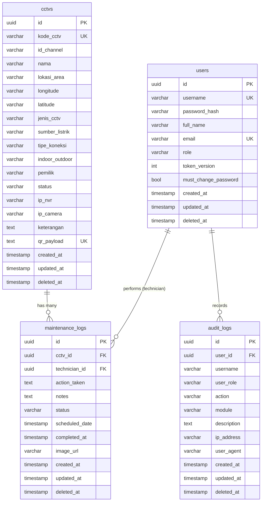

# SIGAP (Sistem Informasi & Inventaris CCTV Terpadu)


Platform manajemen aset CCTV berbasis web untuk monitoring, inventarisasi, dan pemeliharaan perangkat CCTV secara terpusat dengan sistem QR Code terenkripsi.

---

## 🚀 Fitur Utama

- **Dashboard Analitik Real-time**: Total CCTV, statistik pemeliharaan bulan ini, tren 6 bulan, distribusi status, dan peringatan pekerjaan **overdue**.
- **Notifikasi Tugas Teknisi**: Ringkasan tugas aktif & terlambat (`GET /api/dashboard/tasks`) dengan badge status.
- **Master Data CCTV**: Fitur lengkap CRUD dengan filter, pencarian, paginasi, ekspor CSV, dan QR Code terenkripsi AES-256-GCM sebagai satu-satunya sumber kebenaran aset.
- **QR Code Scanner**: Menggunakan kamera perangkat secara langsung di browser (didukung oleh `html5-qrcode`).
- **Import Massal & Template**: Memasukkan data CCTV dalam jumlah besar melalui Excel (`.xlsx`) dengan template standar; batas aman 4 MB / 1000 baris.
- **Bulk Delete**: Fitur hapus massal dan pengosongan data untuk efisiensi manajemen.
- **Log Pemeliharaan**: Pencatatan riwayat pemeliharaan (CRUD, filter status & rentang tanggal, ekspor CSV, laporan **PDF**, unggah foto bukti pekerjaan) yang terhubung langsung ke CCTV.
- **Upload Foto Aman & Privat**: Foto bukti dinormalisasi ke JPEG (metadata EXIF/GPS terhapus), akses file dilindungi JWT, dan file yatim dibersihkan otomatis.
- **Manajemen Pengguna & RBAC**: Kontrol penuh terhadap akun (Admin/Teknisi) dengan CRUD, reset password, dan paksa ganti password saat login pertama.
- **Halaman Profil & Change Password**: Pengguna dapat mengubah nama tampilan dan password sendiri.
- **Audit Log**: Rekam jejak aktivitas (admin-only) dengan filter tanggal dan ekspor CSV.
- **Autentikasi Aman**: JWT (HMAC-SHA256) dalam cookie httpOnly + proteksi CSRF, RBAC, blacklist/revoke token, sliding session, dan rate limiting.
- **Dark/Light Mode**: Toggle tema antarmuka (Gelap/Terang) sesuai kenyamanan pengguna.
- **Dokumentasi API Otomatis**: Integrasi Swagger UI untuk eksplorasi dan pengujian API secara interaktif.
- **Stabilitas Sistem**: Rate limiting untuk mencegah _abuse_, security headers (CSP/HSTS), dan _graceful shutdown_.
- **Deployment Mudah & Aman**: _Dockerized full-stack deployment_ dengan reverse proxy Nginx + TLS, secret management via `.env`, dan Swagger nonaktif di produksi.

---

## 🛠 Tech Stack

| Layer | Teknologi | Versi |
| :--- | :--- | :--- |
| **Backend** | Go, Fiber, GORM | Go 1.26, Fiber v2.52.14, GORM v1.31.2 |
| **Frontend** | Next.js, React, Tailwind CSS, Lucide React | Next.js 16.2.11, React 19.2.4, Tailwind CSS v4 |
| **Database** | PostgreSQL Alpine | 15 |
| **Containerization** | Docker, Docker Compose, Nginx reverse proxy | - |
| **Auth** | JWT, Bcrypt | golang-jwt/jwt v5 |
| **Enkripsi** | AES-256-GCM | crypto/aes |
| **Dokumentasi API** | Swagger/OpenAPI | swaggo/swag |
| **QR Scanner** | html5-qrcode | v2.3.8 |
| **QR Code Server-side** | skip2/go-qrcode | - |
| **Excel Processing**| excelize | v2 |
| **Laporan PDF** | go-pdf/fpdf | v0.9.0 |
| **Logger** | Uber Zap | - |
| **Validation** | go-playground/validator | v10 |
| **Realtime** | Fiber WebSocket | v2 |

---

## 🏗 Arsitektur Sistem

```mermaid
graph TD
    Browser((Browser))
    Nginx[Reverse Proxy Nginx\n:80 / :443 (TLS)]
    Frontend[Next.js Frontend\n:3000 internal]
    Backend[Go Fiber API\n:3000 internal]
    DB[(PostgreSQL\n:5432 internal)]

    Browser -- "HTTPS /api/*, /swagger/*, WS /api/ws" --> Nginx
    Browser -- "HTTPS aplikasi web" --> Nginx
    Nginx -- "proxy /api/*, /swagger/*" --> Backend
    Nginx -- "proxy / (halaman)" --> Frontend
    Frontend -- "REST API Calls (rewrite /api)" --> Backend
    Backend -- "SQL Queries" --> DB

    subgraph Docker Network [sigap_network]
        Nginx
        Frontend
        Backend
        DB
    end
```

---

## 📂 Struktur Proyek

```text
SIGAP/
├── docker-compose.yml          # Orkestrasi db, api, frontend, nginx (TLS)
├── nginx/                      # Reverse proxy + sertifikat TLS
├── .env.example                # Template secret untuk Docker Compose
├── makefile
├── README.md
├── .gitignore
├── docs/
│   ├── changelog.md            # Changelog milestrone monorepo
│   ├── ROADMAP.md              # Rencana pengembangan & status fase
│   ├── SECURITY-AUDIT.md       # Hasil audit keamanan & status perbaikan
│   ├── PRODUCT.md              # Visi & prinsip produk
│   ├── DESIGN.md               # Panduan desain sistem
│   ├── agent.md                # Aturan kerja untuk AI agent
│   └── plan.md                 # Dokumen perencanaan
├── backend/
│   ├── main.go                    # Entry point, Fiber init, migrasi, graceful shutdown
│   ├── Dockerfile                 # Multi-stage Go build
│   ├── go.mod / go.sum
│   ├── .env.example               # Template env lokal
│   ├── .env.docker.example        # Template env Docker
│   ├── config/
│   │   ├── database.go            # Koneksi PostgreSQL + connection pooling
│   │   └── migrate.go             # Migrasi legacy asset_id → cctv_id
│   ├── models/
│   │   ├── setup.go               # Base, User, MaintenanceLog structs
│   │   ├── cctv.go                # CCTV struct (sumber kebenaran aset)
│   │   ├── audit_log.go           # AuditLog struct
│   │   └── seeder.go              # SeedAdmin (tanpa reset tiap startup)
│   ├── handlers/
│   │   ├── auth.go                # Login, me, profile, change-password, create user
│   │   ├── user.go                # CRUD user, ResetPassword (admin)
│   │   ├── cctv.go                # CRUD, Scan, Template, Import, BulkDelete, QR
│   │   ├── maintenance.go         # CRUD, Export CSV, filter tanggal, scope per role
│   │   ├── dashboard.go           # Summary & Tasks
│   │   ├── audit.go               # List & Export audit log (admin)
│   │   ├── report.go              # Laporan pemeliharaan PDF
│   │   ├── upload.go              # Upload (strip EXIF) & serve file
│   │   └── health.go              # Health check
│   ├── middleware/
│   │   ├── auth.go                # JWT Protected & RequireRole
│   │   ├── csrf.go                # CSRF double-submit check
│   │   ├── security.go            # Security headers (CSP/HSTS)
│   │   ├── limiter.go             # Rate limiting
│   │   ├── logger.go              # Zap HTTP logger
│   │   └── recovery.go            # Panic recovery
│   ├── routes/
│   │   ├── auth.go, user.go, cctv.go, maintenance.go, dashboard.go,
│   │   ├── audit.go, upload.go, websocket.go
│   ├── utils/
│   │   ├── encryption.go          # AES-256-GCM encrypt/decrypt
│   │   ├── jwt.go                 # Token generate/validate + token version
│   │   ├── csrf.go / session.go   # Cookie CSRF & session helpers
│   │   ├── audit.go               # LogAudit (async)
│   │   ├── blacklist.go           # JWT blacklist + cleanup
│   │   ├── websocket.go           # Event broadcast
│   │   ├── pagination.go          # SQL-safe pagination + date range
│   │   ├── logger.go              # Zap dual output logger
│   │   └── validator.go           # Struct validation
│   ├── docs/                      # Auto-generated Swagger
│   └── uploads/                   # Foto pemeliharaan
├── frontend/
│   ├── Dockerfile                 # Multi-stage Next.js build
│   ├── package.json
│   ├── next.config.ts             # Rewrites /api → backend
│   ├── src/
│   │   ├── app/
│   │   │   ├── layout.tsx         # Root layout + providers
│   │   │   ├── globals.css        # Tailwind v4 + custom animations
│   │   │   ├── login/page.tsx     # Halaman login
│   │   │   ├── dashboard/page.tsx # Dashboard analitik & tugas
│   │   │   ├── cctv/page.tsx      # Master CCTV + QR Scanner
│   │   │   ├── maintenance/page.tsx # Log pemeliharaan
│   │   │   ├── audit-logs/page.tsx  # Audit log (admin)
│   │   │   ├── change-password/page.tsx # Ganti password
│   │   │   ├── profile/page.tsx   # Profil pengguna
│   │   │   └── users/page.tsx     # Manajemen pengguna
│   │   ├── components/
│   │   │   ├── DashboardLayout.tsx # Sidebar + header layout
│   │   │   ├── DashboardAnalytics.tsx / DashboardStats.tsx
│   │   │   ├── AuthenticatedImage.tsx # Gambar via API (JWT)
│   │   │   ├── CCTVMap.tsx / ProtectedRoute.tsx
│   │   ├── context/
│   │   │   ├── AuthContext.tsx     # JWT auth state + sliding session
│   │   │   ├── ThemeContext.tsx    # Dark/light mode
│   │   │   └── WebSocketContext.tsx # Realtime events
│   │   └── lib/
│   │       └── api.ts             # Fetch wrapper + CSRF + auto 401 redirect
│   └── public/                    # Static assets
└── docs/
    └── plan.md                    # Dokumen perencanaan
```

---

## 🗃 Entity Relationship Diagram (ERD)



---

## 🔌 API Endpoints

> Semua rute berada di bawah prefix `/api`. Endpoint berlabel **JWT** dilindungi autentikasi
> (cookie `sigap_session` atau header `Bearer`); **CSRF** header `X-CSRF-Token` wajib untuk mutasi.
> Swagger UI: `/swagger/index.html` (nonaktif di environment `production`).

### Autentikasi & Profil
| Method | Endpoint | Deskripsi | Auth | Role |
|--------|----------|-----------|------|------|
| POST | `/api/auth/login` | Login pengguna | Publik | - |
| POST | `/api/auth/logout` | Logout (revoke token) | JWT | Semua |
| GET | `/api/auth/me` | Profil pengguna saat ini | JWT | Semua |
| PUT | `/api/auth/profile` | Perbarui nama tampilan sendiri | JWT | Semua |
| POST | `/api/auth/change-password` | Ganti password sendiri (self-service) | JWT | Semua |
| POST | `/api/auth/users` | Buat akun baru (admin) | JWT | Admin |

### Master Data CCTV
| Method | Endpoint | Deskripsi | Auth | Role |
|--------|----------|-----------|------|------|
| GET | `/api/cctv/` | Daftar CCTV (paginasi, filter, search) | JWT | Semua |
| GET | `/api/cctv/template` | Download template Excel | JWT | Semua |
| GET | `/api/cctv/:id/qrcode` | Download QR Code PNG (server-side) | JWT | Semua |
| POST | `/api/cctv/scan` | Scan & identifikasi QR payload | JWT | Semua |
| GET | `/api/cctv/:id` | Detail CCTV | JWT | Semua |
| POST | `/api/cctv/` | Tambah CCTV baru | JWT | Admin |
| POST | `/api/cctv/import` | Import massal dari Excel | JWT | Admin |
| POST | `/api/cctv/bulk-delete` | Hapus massal/kosongkan data | JWT | Admin |
| PUT | `/api/cctv/:id` | Update CCTV | JWT | Admin |
| DELETE | `/api/cctv/:id` | Hapus CCTV (soft delete) | JWT | Admin |

### Log Pemeliharaan
| Method | Endpoint | Deskripsi | Auth | Role |
|--------|----------|-----------|------|------|
| GET | `/api/maintenance-logs/` | Daftar log (paginasi, filter status/tanggal) | JWT | Semua |
| GET | `/api/maintenance-logs/export` | Ekspor log ke CSV | JWT | Teknisi: data miliknya / Admin: semua |
| GET | `/api/maintenance-logs/report-pdf` | Unduh laporan PDF | JWT | Teknisi: data miliknya / Admin: semua |
| GET | `/api/maintenance-logs/:id` | Detail log | JWT | Semua |
| POST | `/api/maintenance-logs/` | Catat pemeliharaan baru | JWT | Semua |
| PUT | `/api/maintenance-logs/:id` | Update log pemeliharaan | JWT | Teknisi: log miliknya / Admin: semua |
| DELETE | `/api/maintenance-logs/:id` | Hapus log (soft delete) | JWT | Admin |

### Pengecekan Lapangan
| Method | Endpoint | Deskripsi | Auth | Role |
|--------|----------|-----------|------|------|
| GET | `/api/field-maintenance/` | Daftar hasil pengecekan lapangan (paginasi, filter, search) | JWT | Teknisi: miliknya / Admin: semua |
| GET | `/api/field-maintenance/:id` | Detail checklist dan foto bukti | JWT | Teknisi: miliknya / Admin: semua |
| GET | `/api/field-maintenance/:id/report-pdf` | Unduh laporan PDF pengecekan lapangan | JWT | Teknisi: miliknya / Admin: semua |
| POST | `/api/field-maintenance/` | Catat hasil pengecekan lapangan | JWT | Semua |
| DELETE | `/api/field-maintenance/:id` | Hapus catatan (soft delete) | JWT | Admin |

### Manajemen Pengguna
| Method | Endpoint | Deskripsi | Auth | Role |
|--------|----------|-----------|------|------|
| GET | `/api/users/` | Daftar pengguna | JWT | Admin |
| GET | `/api/users/:id` | Detail pengguna | JWT | Admin |
| PUT | `/api/users/:id` | Update pengguna | JWT | Admin |
| DELETE | `/api/users/:id` | Hapus pengguna (soft delete) | JWT | Admin |
| POST | `/api/users/:id/reset-password` | Reset password | JWT | Admin |

### Audit Log
| Method | Endpoint | Deskripsi | Auth | Role |
|--------|----------|-----------|------|------|
| GET | `/api/audit-logs/` | Daftar audit log (filter tanggal) | JWT | Admin |
| GET | `/api/audit-logs/export` | Ekspor audit log ke CSV | JWT | Admin |

### Dashboard
| Method | Endpoint | Deskripsi | Auth | Role |
|--------|----------|-----------|------|------|
| GET | `/api/dashboard/summary` | Statistik, tren, distribusi status, overdue | JWT | Semua |
| GET | `/api/dashboard/tasks` | Tugas teknisi (Teknisi: miliknya / Admin: semua) | JWT | Semua |

### Upload, WebSocket & Utilitas
| Method | Endpoint | Deskripsi | Auth | Role |
|--------|----------|-----------|------|------|
| POST | `/api/upload` | Upload foto (JPEG/PNG/WebP, max 2MB; dinormalisasi ke JPEG, EXIF/GPS dihapus) | JWT | Semua |
| GET | `/api/uploads/:filename` | Ambil foto (dilindungi JWT) | JWT | Semua |
| GET | `/api/ws` | WebSocket real-time (event maintenance, auth) | JWT | Semua |
| GET | `/api/health` | Health check API & DB | Publik | - |
| GET | `/swagger/*` | Dokumentasi API Swagger UI | Publik | - |

---

## 🐳 Panduan Instalasi (Docker)

Panduan berikut dirancang untuk memudahkan instalasi dan menjalankan aplikasi menggunakan **Docker Desktop** di lingkungan Windows.

### Prasyarat
- [Docker Desktop](https://www.docker.com/products/docker-desktop) terinstal dan berjalan di sistem Anda.
- [Git](https://git-scm.com/) terinstal.

### Langkah-langkah

1. **Clone repositori**
   Buka terminal atau command prompt, lalu jalankan perintah berikut:
   ```bash
   git clone https://github.com/notyourkise/SIGAP.git
   cd SIGAP
   ```

2. **Siapkan file environment**
   Salin template dan isi nilai asli (secret wajib diisi, lihat langkah 3):
   ```bash
   cp .env.example .env
   cp backend/.env.docker.example backend/.env.docker
   ```

3. **Isi secret penting**
   - `.env` (root): `POSTGRES_PASSWORD` **wajib** diisi — `docker compose` akan menolak `up` bila kosong.
   - `backend/.env.docker`: `DB_PASSWORD` (harus cocok), `JWT_SECRET`, `AES_SECRET_KEY`, `ADMIN_DEFAULT_PASSWORD` (min. 8 karakter, dipakai hanya saat akun admin dibuat pertama kali), dan `CORS_ALLOWED_ORIGINS=https://localhost`.

4. **Buat sertifikat TLS** (untuk reverse proxy Nginx)
   Ikuti petunjuk di `nginx/certs/README.md` untuk membuat sertifikat `self-signed` (development) atau menempatkan sertifikat resmi (produksi).

5. **Build dan jalankan container**
   Jalankan seluruh _stack_ aplikasi (Database, Backend, Frontend, Nginx) di latar belakang:
   ```bash
   docker compose up --build -d
   ```

6. **Verifikasi container berjalan**
   Pastikan semua _services_ berjalan dengan status `Up`:
   ```bash
   docker compose ps
   ```

7. **Akses aplikasi**
   Aplikasi diakses melalui reverse proxy Nginx (bukan port langsung):
   - **Frontend (Aplikasi Web)**: [https://localhost](https://localhost) *(satu-satunya entrypoint Docker; `http://localhost` hanya redirect ke HTTPS)*
   - **Swagger UI (Dokumentasi API)**: `https://localhost/swagger/index.html` *(non-production)*

8. **Login dengan akun default**
   - **Username**: `admin`
   - **Password**: nilai `ADMIN_DEFAULT_PASSWORD` yang Anda set di langkah 3.
   *(Sistem akan memaksa Anda mengganti password pada login pertama.)*

### Perintah Docker Berguna
- Melihat log real-time semua service: `docker compose logs -f`
- Menghentikan sementara semua container: `docker compose stop`
- Menghentikan dan menghapus container: `docker compose down`
- Menghapus container sekaligus volume database (reset total): `docker compose down -v`
- Membangun ulang (rebuild) image jika ada perubahan kode: `docker compose up --build -d`

---

## 💻 Panduan Instalasi (Lokal / Tanpa Docker)

Gunakan panduan ini jika Anda ingin melakukan pengembangan sistem (development) secara langsung di komputer tanpa menggunakan Docker.

### Prasyarat
- Go >= 1.26
- Node.js >= 20
- PostgreSQL 15

### Langkah-langkah Backend
1. Masuk ke direktori backend:
   ```bash
   cd backend
   ```
2. Salin dan sesuaikan environment variabel:
   ```bash
   cp .env.example .env
   ```
   *(Edit file `.env` dan pastikan konfigurasi host, port, user, dan password database sudah sesuai dengan pengaturan PostgreSQL lokal Anda.)*
3. Unduh semua _dependencies_ dan jalankan server:
   ```bash
   go mod download
   go run main.go
   ```
   *(Backend akan berjalan di port `3000`)*

### Langkah-langkah Frontend
1. Buka terminal baru dan masuk ke direktori frontend:
   ```bash
   cd frontend
   ```
2. Instal semua _dependencies_ paket Node.js:
   ```bash
   npm install
   ```
3. Jalankan server frontend di mode pengembangan:
   ```bash
   npm run dev
   ```
   *(Frontend akan berjalan di port `3001`)*

---

## ⚙️ Environment Variables

Konfigurasi sistem diatur melalui _environment variables_. Berikut adalah referensi lengkapnya
(backend: `backend/.env` atau `backend/.env.docker`; Docker Compose: root `.env`):

| Variable | Deskripsi | Default | Wajib |
|----------|-----------|---------|-------|
| `DB_HOST` | Host database | `localhost` (Docker: `db`) | Ya |
| `DB_PORT` | Port database | `5432` | Ya |
| `DB_USER` | Username database | - | Ya |
| `DB_PASSWORD` | Password database | - | Ya |
| `DB_NAME` | Nama database | - | Ya |
| `JWT_SECRET` | Secret key JWT | - | Ya |
| `AES_SECRET_KEY` | Secret key AES-256 enkripsi QR | - | Ya |
| `ADMIN_DEFAULT_PASSWORD` | Password admin awal (hanya saat DB kosong, min. 8) | - | Ya (DB baru) |
| `APP_ENV` | Environment (`development`/`staging`/`production`); nonaktifkan Swagger di produksi | `development` | Tidak |
| `CORS_ALLOWED_ORIGINS` | Origin yang diizinkan (pisahkan koma; tanpa wildcard) | Lokal: `http://localhost:3001`; Docker: `https://localhost` | Tidak |
| `TRUSTED_PROXY_IPS` | IP proxy yang dipercaya untuk header IP | kosong (aman) | Tidak |
| `DB_MAX_OPEN_CONNS` | Max open connections | `50` | Tidak |
| `DB_MAX_IDLE_CONNS` | Max idle connections | `10` | Tidak |
| `DB_CONN_MAX_LIFETIME` | Connection max lifetime (menit) | `30` | Tidak |
| `DB_CONN_MAX_IDLE_TIME` | Idle connection max time (menit) | `10` | Tidak |
| `NEXT_PUBLIC_API_URL` | URL API untuk frontend (lokal) | `/api` | Tidak |
| `POSTGRES_USER` | (Docker) User PostgreSQL root `.env` | `sigap_user` | Tidak |
| `POSTGRES_PASSWORD` | (Docker) Password PostgreSQL — wajib via root `.env` | - | Ya (Docker) |
| `POSTGRES_DB` | (Docker) Nama DB PostgreSQL | `sigap_db` | Tidak |

---

## 🔑 Kredensial Default

Setelah instalasi dan seeding data awal berjalan sukses, satu akun Administrator akan otomatis dibuat
dengan password dari `ADMIN_DEFAULT_PASSWORD` (tidak ada password hardcoded).

- **Username**: `admin`
- **Password**: nilai `ADMIN_DEFAULT_PASSWORD` (diatur saat instalasi)

> [!WARNING]
> Password admin **tidak di-reset** oleh seeder pada setiap startup (aman dari pengambilalihan).
> Sistem akan **memaksa penggantian password** pada login pertama.

---

## 📄 Lisensi

Proyek ini dibangun dan ditujukan sebagai **Proyek Internal / Akademik**.
