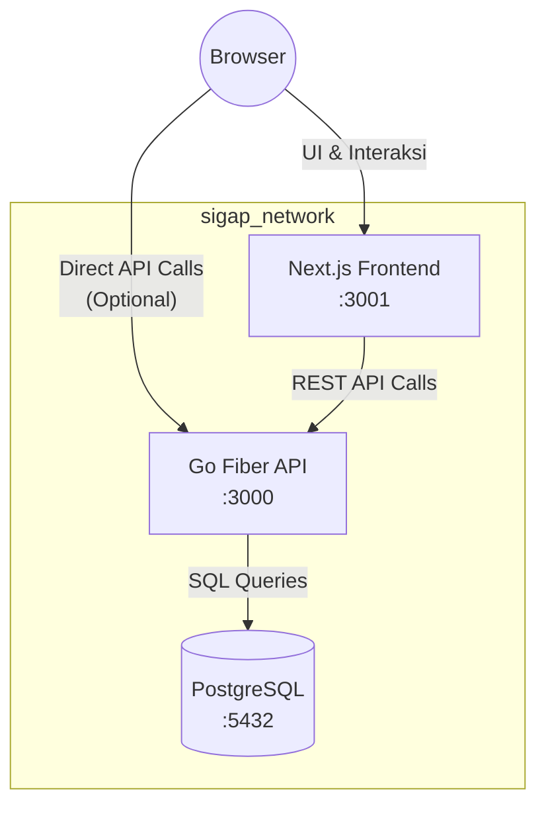
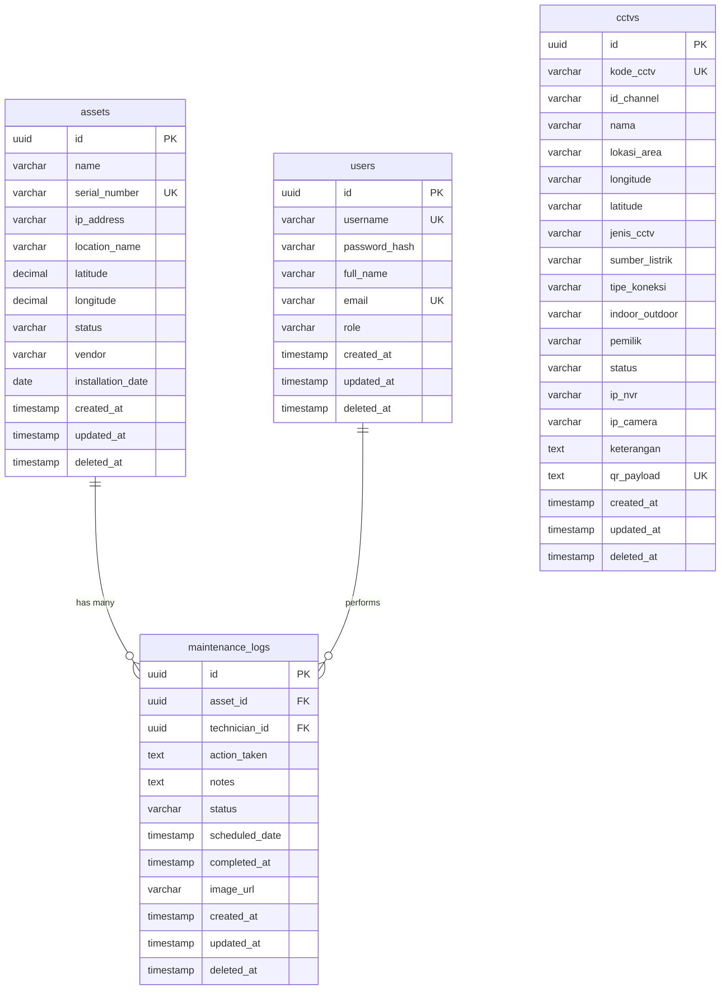

# SIGAP (Sistem Informasi & Inventaris CCTV Terpadu)


Platform manajemen aset CCTV berbasis web untuk monitoring, inventarisasi, dan pemeliharaan perangkat CCTV secara terpusat dengan sistem QR Code terenkripsi.

---

## 🚀 Fitur Utama

- **Dashboard Statistik Real-time**: Memantau total aset, status breakdown, dan aktivitas bulan ini secara langsung.
- **Manajemen Aset CCTV**: Fitur lengkap CRUD (Create, Read, Update, Delete) dengan dukungan filter, pencarian, paginasi, dan ekspor data ke format CSV.
- **Master Data CCTV**: Terintegrasi dengan QR Code yang dienkripsi menggunakan standar AES-256 untuk keamanan data tingkat tinggi.
- **QR Code Scanner**: Menggunakan kamera perangkat secara langsung di browser (didukung oleh `html5-qrcode`).
- **Import Massal**: Memasukkan data CCTV dalam jumlah besar dengan mudah melalui file Excel (`.xlsx`).
- **Template Standar**: Download template Excel standar untuk mempermudah proses import data.
- **Bulk Delete**: Fitur hapus massal dan pengosongan data untuk efisiensi manajemen.
- **Log Pemeliharaan**: Pencatatan riwayat pemeliharaan lengkap (CRUD, filter, pencarian, ekspor CSV, hingga unggah foto bukti pekerjaan).
- **Manajemen Pengguna**: Kontrol penuh terhadap akses pengguna dengan fitur CRUD dan reset password.
- **Autentikasi Aman**: Menggunakan JWT (JSON Web Tokens) dengan penerapan _role-based access control_ (Admin & Teknisi).
- **Dark/Light Mode**: Toggle tema antarmuka (Gelap/Terang) sesuai kenyamanan pengguna.
- **Dokumentasi API Otomatis**: Integrasi Swagger UI untuk eksplorasi dan pengujian API secara interaktif.
- **Stabilitas Sistem**: Dilengkapi dengan _rate limiting_ untuk mencegah _abuse_ dan _graceful shutdown_ untuk memastikan tidak ada data yang terputus saat proses dihentikan.
- **Deployment Mudah**: _Dockerized full-stack deployment_ untuk menjamin konsistensi _environment_ dari _development_ hingga _production_.

---

## 🛠 Tech Stack

| Layer | Teknologi | Versi |
| :--- | :--- | :--- |
| **Backend** | Go, Fiber, GORM | Go 1.26, Fiber v2.52.14, GORM v1.31.2 |
| **Frontend** | Next.js, React, Tailwind CSS, Lucide React | Next.js 16.2.11, React 19.2.4, Tailwind CSS v4 |
| **Database** | PostgreSQL Alpine | 15 |
| **Containerization** | Docker, Docker Compose | - |
| **Auth** | JWT, Bcrypt | golang-jwt/jwt v5 |
| **Enkripsi** | AES-256-GCM | crypto/aes |
| **Dokumentasi API** | Swagger/OpenAPI | swaggo/swag |
| **QR Scanner** | html5-qrcode | v2.3.8 |
| **Excel Processing**| excelize | v2 |
| **Logger** | Uber Zap | - |
| **Validation** | go-playground/validator | v10 |

---

## 🏗 Arsitektur Sistem



---

## 📂 Struktur Proyek

```text
SIGAP/
├── docker-compose.yml
├── makefile
├── README.md
├── agent.md
├── .gitignore
├── backend/
│   ├── main.go                    # Entry point, Fiber init, graceful shutdown
│   ├── Dockerfile                 # Multi-stage Go build
│   ├── go.mod / go.sum
│   ├── .env.example               # Template env lokal
│   ├── .env.docker.example        # Template env Docker
│   ├── config/
│   │   └── database.go            # Koneksi PostgreSQL + connection pooling
│   ├── models/
│   │   ├── setup.go               # Base, User, Asset, MaintenanceLog structs
│   │   ├── cctv.go                # CCTV struct
│   │   └── seeder.go              # SeedAdmin, SeedAssets
│   ├── handlers/
│   │   ├── auth.go                # Login, CreateUser
│   │   ├── asset.go               # CRUD, Export CSV, QR Code PNG
│   │   ├── cctv.go                # CRUD, Scan, Template, Import, BulkDelete
│   │   ├── maintenance.go         # CRUD, Export CSV
│   │   ├── user.go                # CRUD, ResetPassword
│   │   ├── dashboard.go           # Statistik agregat
│   │   ├── upload.go              # Upload foto
│   │   └── health.go              # Health check
│   ├── middleware/
│   │   ├── auth.go                # JWT Protected & RequireRole
│   │   ├── limiter.go             # Rate limiting
│   │   ├── logger.go              # Zap HTTP logger
│   │   └── recovery.go            # Panic recovery
│   ├── routes/
│   │   ├── auth.go, asset.go, cctv.go, maintenance.go, user.go, upload.go
│   ├── utils/
│   │   ├── encryption.go          # AES-256-GCM encrypt/decrypt
│   │   ├── jwt.go                 # Token generate/validate
│   │   ├── logger.go              # Zap dual output logger
│   │   ├── pagination.go          # SQL-safe pagination
│   │   └── validator.go           # Struct validation
│   ├── docs/                      # Auto-generated Swagger
│   └── uploads/                   # Foto pemeliharaan
├── frontend/
│   ├── Dockerfile                 # Multi-stage Next.js build
│   ├── package.json
│   ├── next.config.ts
│   ├── src/
│   │   ├── app/
│   │   │   ├── layout.tsx         # Root layout + providers
│   │   │   ├── globals.css        # Tailwind v4 + custom animations
│   │   │   ├── page.tsx           # Dashboard Aset CCTV
│   │   │   ├── cctv/page.tsx      # Master CCTV + QR Scanner
│   │   │   ├── login/page.tsx     # Halaman login
│   │   │   └── maintenance/page.tsx # Log pemeliharaan
│   │   ├── components/
│   │   │   ├── DashboardLayout.tsx # Sidebar + header layout
│   │   │   └── ProtectedRoute.tsx # Auth guard
│   │   ├── context/
│   │   │   ├── AuthContext.tsx     # JWT auth state
│   │   │   └── ThemeContext.tsx    # Dark/light mode
│   │   └── lib/
│   │       └── api.ts             # Fetch wrapper + auto 401 redirect
│   └── public/                    # Static assets
└── docs/
    └── plan.md                    # Dokumen perencanaan
```

---

## 🗃 Entity Relationship Diagram (ERD)



---

## 🔌 API Endpoints

### Autentikasi
| Method | Endpoint | Deskripsi | Auth | Role |
|--------|----------|-----------|------|------|
| POST | `/api/auth/login` | Login pengguna | Publik | - |
| POST | `/api/auth/users` | Registrasi user baru | JWT | Admin |

### Aset CCTV
| Method | Endpoint | Deskripsi | Auth | Role |
|--------|----------|-----------|------|------|
| GET | `/api/assets/` | Daftar aset (paginasi, filter, search) | JWT | Semua |
| GET | `/api/assets/export` | Ekspor aset ke CSV | JWT | Semua |
| GET | `/api/assets/:id` | Detail aset | JWT | Semua |
| GET | `/api/assets/:id/qrcode` | Download QR Code PNG | JWT | Semua |
| POST | `/api/assets/` | Tambah aset baru | JWT | Admin |
| PUT | `/api/assets/:id` | Update aset | JWT | Admin |
| DELETE | `/api/assets/:id` | Hapus aset (soft delete) | JWT | Admin |

### Master Data CCTV
| Method | Endpoint | Deskripsi | Auth | Role |
|--------|----------|-----------|------|------|
| GET | `/api/cctv/` | Daftar CCTV (paginasi, filter, search) | JWT | Semua |
| GET | `/api/cctv/template` | Download template Excel | JWT | Semua |
| GET | `/api/cctv/:id` | Detail CCTV | JWT | Semua |
| POST | `/api/cctv/` | Tambah CCTV baru | JWT | Admin |
| POST | `/api/cctv/scan` | Scan & identifikasi QR payload | JWT | Semua |
| POST | `/api/cctv/import` | Import massal dari Excel | JWT | Admin |
| POST | `/api/cctv/bulk-delete`| Hapus massal/kosongkan data | JWT | Admin |
| PUT | `/api/cctv/:id` | Update CCTV | JWT | Admin |
| DELETE | `/api/cctv/:id` | Hapus CCTV (soft delete) | JWT | Admin |

### Log Pemeliharaan
| Method | Endpoint | Deskripsi | Auth | Role |
|--------|----------|-----------|------|------|
| GET | `/api/maintenance-logs/` | Daftar log (paginasi, filter) | JWT | Semua |
| GET | `/api/maintenance-logs/export`| Ekspor log ke CSV | JWT | Semua |
| GET | `/api/maintenance-logs/:id`| Detail log | JWT | Semua |
| POST | `/api/maintenance-logs/` | Catat pemeliharaan baru | JWT | Semua |
| PUT | `/api/maintenance-logs/:id`| Update log pemeliharaan | JWT | Semua |
| DELETE | `/api/maintenance-logs/:id`| Hapus log (soft delete) | JWT | Admin |

### Manajemen Pengguna
| Method | Endpoint | Deskripsi | Auth | Role |
|--------|----------|-----------|------|------|
| GET | `/api/users/` | Daftar pengguna | JWT | Admin |
| GET | `/api/users/:id` | Detail pengguna | JWT | Admin |
| PUT | `/api/users/:id` | Update pengguna | JWT | Admin |
| DELETE | `/api/users/:id` | Hapus pengguna (soft delete) | JWT | Admin |
| POST | `/api/users/:id/reset-password`| Reset password | JWT | Admin |

### Upload & Utilitas
| Method | Endpoint | Deskripsi | Auth | Role |
|--------|----------|-----------|------|------|
| POST | `/api/upload` | Upload foto (JPEG/PNG/WebP, max 2MB) | JWT | Semua |
| GET | `/api/health` | Health check API & DB | Publik | - |
| GET | `/api/dashboard/stats` | Statistik dashboard | JWT | Semua |
| GET | `/swagger/*` | Dokumentasi API Swagger UI | Publik | - |

---

## 🐳 Panduan Instalasi (Docker)

Panduan berikut dirancang untuk memudahkan instalasi dan menjalankan aplikasi menggunakan **Docker Desktop** di lingkungan Windows.

### Prasyarat
- [Docker Desktop](https://www.docker.com/products/docker-desktop) terinstal dan berjalan di sistem Anda.
- [Git](https://git-scm.com/) terinstal.

### Langkah-langkah

1. **Clone repositori**
   Buka terminal atau command prompt, lalu jalankan perintah berikut:
   ```bash
   git clone https://github.com/notyourkise/SIGAP.git
   cd SIGAP
   ```

2. **Salin file environment**
   Siapkan konfigurasi environment variabel:
   ```bash
   cp backend/.env.docker.example backend/.env.docker
   ```
   *(Opsional: Buka file `backend/.env.docker` dan sesuaikan kredensial seperti password database atau secret key jika diperlukan.)*

3. **Build dan jalankan container**
   Jalankan seluruh _stack_ aplikasi (Frontend, Backend, Database) di latar belakang:
   ```bash
   docker compose up --build -d
   ```

4. **Verifikasi container berjalan**
   Pastikan semua _services_ berjalan dengan status `Up`:
   ```bash
   docker compose ps
   ```

5. **Akses aplikasi**
   Aplikasi siap digunakan melalui _browser_:
   - **Frontend (Aplikasi Web)**: [http://localhost:3001](http://localhost:3001)
   - **Backend API Base URL**: [http://localhost:3000/api](http://localhost:3000/api)
   - **Swagger UI (Dokumentasi API)**: [http://localhost:3000/swagger/index.html](http://localhost:3000/swagger/index.html)

6. **Login dengan akun default**
   Gunakan kredensial berikut untuk masuk sebagai Administrator:
   - **Username**: `admin`
   - **Password**: `adminpassword`
   *(⚠️ Sangat disarankan untuk segera mengubah password ini di sistem.)*

### Perintah Docker Berguna
- Melihat log real-time semua service: `docker compose logs -f`
- Menghentikan sementara semua container: `docker compose stop`
- Menghentikan dan menghapus container: `docker compose down`
- Menghapus container sekaligus volume database (reset total): `docker compose down -v`
- Membangun ulang (rebuild) image jika ada perubahan kode: `docker compose up --build -d`

---

## 💻 Panduan Instalasi (Lokal / Tanpa Docker)

Gunakan panduan ini jika Anda ingin melakukan pengembangan sistem (development) secara langsung di komputer tanpa menggunakan Docker.

### Prasyarat
- Go >= 1.26
- Node.js >= 20
- PostgreSQL 15

### Langkah-langkah Backend
1. Masuk ke direktori backend:
   ```bash
   cd backend
   ```
2. Salin dan sesuaikan environment variabel:
   ```bash
   cp .env.example .env
   ```
   *(Edit file `.env` dan pastikan konfigurasi host, port, user, dan password database sudah sesuai dengan pengaturan PostgreSQL lokal Anda.)*
3. Unduh semua _dependencies_ dan jalankan server:
   ```bash
   go mod download
   go run main.go
   ```
   *(Backend akan berjalan di port `3000`)*

### Langkah-langkah Frontend
1. Buka terminal baru dan masuk ke direktori frontend:
   ```bash
   cd frontend
   ```
2. Instal semua _dependencies_ paket Node.js:
   ```bash
   npm install
   ```
3. Jalankan server frontend di mode pengembangan:
   ```bash
   npm run dev
   ```
   *(Frontend akan berjalan di port `3001`)*

---

## ⚙️ Environment Variables

Konfigurasi sistem diatur melalui _environment variables_. Berikut adalah referensi lengkapnya:

| Variable | Deskripsi | Default | Wajib |
|----------|-----------|---------|-------|
| `DB_HOST` | Host database | `localhost` | Ya |
| `DB_PORT` | Port database | `5432` | Ya |
| `DB_USER` | Username database | - | Ya |
| `DB_PASSWORD` | Password database | - | Ya |
| `DB_NAME` | Nama database | - | Ya |
| `JWT_SECRET` | Secret key JWT | - | Ya |
| `AES_SECRET_KEY` | Secret key AES-256 enkripsi QR | - | Ya |
| `DB_MAX_OPEN_CONNS` | Max open connections | `50` | Tidak |
| `DB_MAX_IDLE_CONNS` | Max idle connections | `10` | Tidak |
| `DB_CONN_MAX_LIFETIME` | Connection max lifetime (menit) | `30` | Tidak |
| `DB_CONN_MAX_IDLE_TIME` | Idle connection max time (menit) | `10` | Tidak |
| `NEXT_PUBLIC_API_URL` | URL API untuk frontend | `http://localhost:3000/api` | Ya |

---

## 🔑 Kredensial Default

Setelah instalasi dan seeding data awal berjalan sukses, satu akun Administrator akan otomatis dibuat.

- **Username**: `admin`
- **Password**: `adminpassword`

> [!WARNING]
> Harap segera mengganti kredensial default ini pada lingkungan *production* atau setelah pertama kali berhasil login demi menjaga keamanan sistem.

---

## 📄 Lisensi

Proyek ini dibangun dan ditujukan sebagai **Proyek Internal / Akademik**.