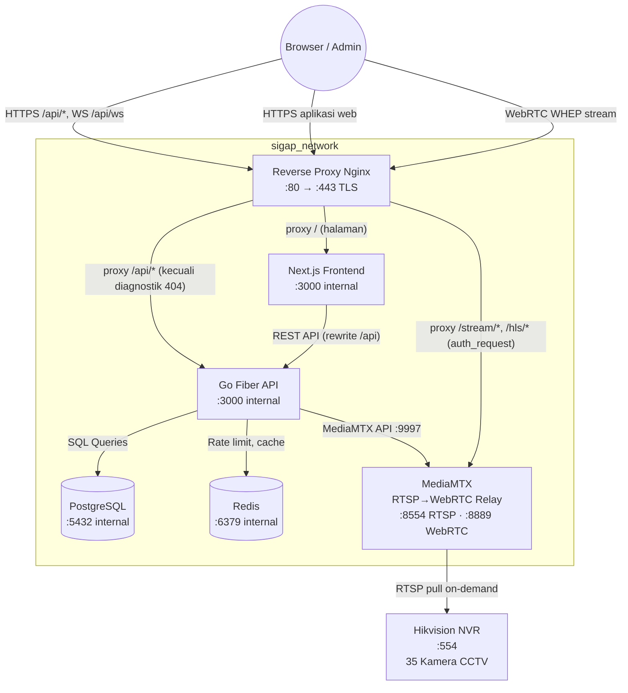
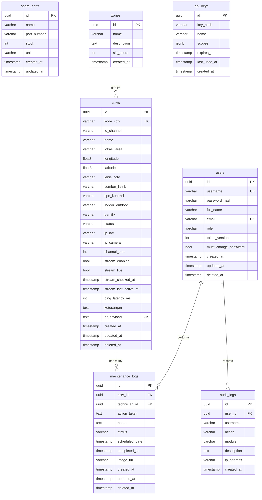

<div align="center">


# SISTEM INFORMASI GANGGUAN & ASET PUSAT

### **S I G A P**

*Platform Manajemen & Monitoring CCTV Terpadu*  
*Kawasan Ibu Kota Nusantara — OIKN*

---


</div>

---

> **Progres Kapita Selekta AI Engineering:** lihat [progres monitoring, tiket otomatis, dan rencana agent AI](PROGRES-AI-ENGINEERING.md). Fitur monitoring insiden tersedia sebagai prototipe dan sedang diuji.

> **SIGAP** adalah sistem internal OIKN untuk monitoring, inventarisasi, dan pemeliharaan seluruh aset CCTV di Kawasan IKN Nusantara secara terpusat. Sistem ini menyediakan live streaming, deteksi status kamera secara real-time, dan manajemen gangguan aset berbasis web.

---

## 🚀 Fitur Utama

- **Dashboard Analitik Real-time** — Statistik total CCTV, pemeliharaan bulan ini, tren 6 bulan, distribusi status, dan peringatan pekerjaan *overdue*.
- **Master Data CCTV** — CRUD lengkap dengan filter site/status, pencarian, paginasi, ekspor CSV, QR Code terenkripsi AES-256-GCM (termasuk rotasi QR), import massal Excel (max 1.000 baris), hapus massal, serta audit kualitas data koordinat (`/api/cctv/coordinate-quality`) + ekspor CSV.
- **QR Code Scanner** — Identifikasi aset CCTV via kamera perangkat langsung di browser (`html5-qrcode`).
- **Peta Sebaran CCTV** — Visualisasi lokasi seluruh 35 kamera di peta interaktif (Leaflet.js). Marker menampilkan status live 🟢/🔴/🟡/⚪ secara real-time. Klik marker untuk popup stream langsung.
- **Live Streaming CCTV** — RTSP → WebRTC via MediaMTX (zero-transcoding, H.264 native). Sub-stream default untuk efisiensi bandwidth, deteksi dukungan H.265/HEVC, dan diagnostik koneksi Metro-E. Akses Live View khusus Admin.
- **Live Status Detection & Log Event CCTV** — Probe otomatis tiap 2 menit untuk kamera Metro-E (`10.20.105.x`, bila rute aktif) atau fallback pasif MediaMTX, verifikasi aktif end-to-end periodik/manual, serta riwayat log di `/cctv/logs` (`Asia/Makassar`, retensi 90 hari). Badge di peta dan monitor grid diperbarui real-time via WebSocket terisolasi site.
- **Monitoring Insiden & Telegram** — Pelacakan insiden stream otomatis (termasuk pemadaman terencana), outbox pesan Telegram, serta halaman `/incidents` (dikendalikan feature flag `CCTV_INCIDENTS_ENABLED`).
- **Monitor Multi-Kamera** — Grid view 2×2, 3×3, 4×4 di halaman `/monitor` (Admin only). Border status live per sel.
- **Log Pemeliharaan** — CRUD riwayat pemeliharaan, filter status & rentang tanggal, ekspor CSV, laporan PDF, unggah foto bukti (EXIF/GPS dihapus otomatis, akses dilindungi JWT).
- **Pengecekan Lapangan** — Checklist dinamis kondisi kamera, geotag opsional, foto bukti, idempotensi offline mobile (`client_request_id`), laporan PDF per kegiatan.
- **Jadwal Pemeliharaan** — Kalender penjadwalan preventif per kamera, notifikasi jadwal jatuh tempo.
- **Inventaris Suku Cadang** — CRUD stok komponen, riwayat penggunaan terhubung ke log pemeliharaan.
- **SLA & Zona** — Kebijakan target penyelesaian per zona, monitoring kepatuhan SLA & laporan overdue.
- **Laporan Kustom** — Laporan pemeliharaan fleksibel berdasarkan filter periode, zona, dan teknisi.
- **Kinerja Teknisi** — Statistik produktivitas dan rekap penyelesaian tugas per teknisi.
- **API Key & Webhook** — Integrasi pihak ketiga via API Key (scoped), webhook event real-time (HMAC-SHA256).
- **Multi-Site** — Isolasi kawasan/site terpusat (`X-Site-ID` / cookie `sigap_site_id`) dengan penugasan teknisi (`user_sites`) fail-closed dan mode lintas site khusus Admin.
- **Push Notification & Email** — Notifikasi browser (PWA) dan email per event (gangguan, SLA, jadwal).
- **Manajemen Pengguna RBAC** — Kontrol akun Admin/Teknisi, reset password, paksa ganti password login pertama.
- **Audit Log** — Rekam jejak seluruh aktivitas operasional (Admin only), ekspor CSV.
- **Dark/Light Mode** — Toggle tema antarmuka sesuai preferensi.
- **Backup Terenkripsi GPG AES-256** — Backup harian database PostgreSQL + uploads (`scripts/backup.sh`, opsi `ENCRYPT_BACKUPS=true`).
- **Dokumentasi API Swagger** — Integrasi Swagger UI (nonaktif di produksi & diblokir Nginx TLS).

---

## 🛠 Tech Stack

| Layer | Teknologi | Versi |
| :--- | :--- | :--- |
| **Backend** | Go, Fiber, GORM | Go 1.26, Fiber v2, GORM v1 |
| **Frontend** | Next.js, React, Tailwind CSS, Lucide React | Next.js 16.4.2, React 19, Tailwind CSS v4 |
| **Database** | PostgreSQL Alpine | 15 |
| **Cache / Pub-Sub** | Redis | 7 Alpine |
| **Streaming** | MediaMTX (RTSP→WebRTC/WHEP) | v1.20.0 |
| **Containerization** | Docker, Docker Compose, Nginx reverse proxy | - |
| **Auth** | JWT, Bcrypt | golang-jwt/jwt v5 |
| **Enkripsi** | AES-256-GCM & GnuPG AES-256 (backup) | crypto/aes + gpg |
| **Dokumentasi API** | Swagger/OpenAPI | swaggo/swag |
| **QR Scanner** | html5-qrcode | v2.3.8 |
| **QR Code Server-side** | skip2/go-qrcode | - |
| **Excel Processing** | excelize | v2 |
| **Laporan PDF** | go-pdf/fpdf | v0.9.0 |
| **Logger** | Uber Zap | - |
| **Validation** | go-playground/validator | v10 |
| **Realtime** | Fiber WebSocket | v2 |
| **Peta** | Leaflet.js | - |
| **Video Player** | WebRTC/WHEP (native browser) | - |

---

## 🏗 Arsitektur Sistem



> **7 Docker service utama:** `db` · `redis` · `api` · `frontend` · `nginx` · `backup` · `mediamtx` *(plus stack observability opsional Prometheus/Grafana di `docker-compose.override.yml`)*.

---

## 📂 Struktur Proyek

```text
SIGAP/
├── docker-compose.yml            # Orkestrasi 7 service (db, redis, api, frontend, nginx, backup, mediamtx)
├── docker-compose.override.yml   # Stack observability opsional (Prometheus & Grafana)
├── mediamtx.yml                  # Konfigurasi MediaMTX (RTSP→WebRTC, path on-demand)
├── nginx/                        # Reverse proxy TLS, security headers, blokir diagnostik (404)
├── backup/                       # Image container backup (PostgreSQL client + dcron + gnupg)
├── monitoring/                   # Konfigurasi Prometheus & dashboard Grafana
├── mobile/                       # React Native Expo mobile app
├── scripts/                      # Skrip backup & restore terenkripsi GPG (backup.sh, restore.sh)
├── secrets/                      # Docker secret files lokal (tidak di-commit)
├── .env.example                  # Template secret & variabel Docker Compose
├── e2e/                          # Pengujian end-to-end Playwright
├── makefile
├── README.md
├── .gitignore
├── docs/
│   ├── README.md                 # Checklist 25 manual test bug SIGAP
│   ├── MIGRATION.md              # Prosedur migrasi DB versioned
│   ├── changelog.md              # Changelog milestone monorepo
│   ├── 01-documentation/         # Dokumentasi arsitektur, ROADMAP, BACKUP, runbook & panduan fitur
│   ├── 02-audits/                # SECURITY-AUDIT & arsip bukti audit
│   ├── 04-manual-tests/          # TESTING.md & skenario uji manual (V1/V2, Telegram, release gate)
│   └── 05-reports/               # TODO perbaikan & laporan verifikasi
├── backend/
│   ├── main.go                   # Entry point, Fiber init, migrasi, background worker, graceful shutdown
│   ├── Dockerfile                # Multi-stage Go build
│   ├── go.mod / go.sum
│   ├── .env.example / .env.docker.example
│   ├── migrations/               # 35 pasangan file migration SQL versioned (golang-migrate)
│   ├── cmd/migrate/              # CLI manual migrasi: up | down | version
│   ├── config/                   # Koneksi DB, Redis, timezone, retensi log, trusted proxy, migrasi
│   ├── models/                   # Struct model DB & seeder idempoten
│   ├── handlers/                 # CRUD, stream probe/verify, koordinat quality, log CCTV, insiden, dll.
│   ├── incidents/                # Engine tiket insiden, planned outage, outbox & bot Telegram
│   ├── aiassistant/              # Asisten operasional berbasis korpus internal
│   ├── middleware/               # Auth JWT/RBAC, CSRF, limiter, metrics CIDR allowlist, SiteContext
│   ├── monitoring/               # Collector & metrik Prometheus
│   ├── routes/                   # Registrasi seluruh route API, WebSocket & media proxy
│   ├── utils/                    # AES-256-GCM, JWT, MediaMTX, RTSP, WebSocket, secrets, logger
│   └── uploads/                  # Foto pemeliharaan (dilindungi JWT)
├── frontend/
│   ├── Dockerfile                # Multi-stage Next.js 16 build
│   ├── package.json
│   ├── next.config.ts            # Rewrites /api → backend
│   ├── public/                   # Manifest PWA, service worker, ikon
│   └── src/
│       ├── proxy.ts              # Guard rute berbasis sesi/peran
│       ├── app/                  # Halaman App Router (cctv, cctv/logs, monitor, incidents, dll.)
│       ├── components/           # DashboardLayout, CCTVMap, SiteSwitcher, WHEPPlayer, dll.
│       ├── context/              # AuthContext, ThemeContext, WebSocketContext
│       └── lib/                  # API client, coordinate-quality, live-status, site-switcher, dll.
```

---

## 🗃 Entity Relationship Diagram (ERD)



---

## 🔌 API Endpoints

> Semua rute berada di bawah prefix `/api`. Endpoint berlabel **JWT** dilindungi autentikasi
> (cookie `sigap_session`); **CSRF** header `X-CSRF-Token` wajib untuk mutasi. Header `X-Site-ID`
> menentukan cakupan site aktif untuk endpoint yang mendukung multi-site.
> Swagger UI: `/swagger/index.html` (nonaktif di environment `production` dan diblokir `404` oleh Nginx TLS).

### Autentikasi & Profil
| Method | Endpoint | Deskripsi | Auth | Role |
|--------|----------|-----------|------|------|
| POST | `/api/auth/login` | Login | Publik | - |
| POST | `/api/auth/logout` | Logout (revoke token) | JWT | Semua |
| GET | `/api/auth/me` | Profil pengguna | JWT | Semua |
| PUT | `/api/auth/profile` | Update nama tampilan | JWT | Semua |
| POST | `/api/auth/change-password` | Ganti password | JWT | Semua |
| POST | `/api/auth/users` | Buat akun baru | JWT | Admin |

### Master Data CCTV, Kualitas Koordinat & Log Event
| Method | Endpoint | Deskripsi | Auth | Role |
|--------|----------|-----------|------|------|
| GET | `/api/cctv/` | Daftar CCTV (paginasi, filter, search) | JWT / API Key | Semua (ter-scope site) |
| GET | `/api/cctv/coordinate-quality` | Audit kualitas data koordinat (`?issue=`, `?format=csv`) | JWT | Semua (ter-scope site) |
| GET | `/api/cctv/logs` | Riwayat event & ringkasan status CCTV (`Asia/Makassar`) | JWT | Semua (ter-scope site) |
| GET | `/api/cctv-logs` | Alias kompatibilitas `/api/cctv/logs` | JWT | Semua (ter-scope site) |
| GET | `/api/cctv/template` | Download template Excel | JWT | Semua |
| GET | `/api/cctv/:id/qrcode` | Download QR Code PNG (`no-store`) | JWT | Semua (ter-scope site) |
| POST | `/api/cctv/scan` | Scan & identifikasi QR payload | JWT | Semua (ter-scope site) |
| GET | `/api/cctv/:id/snapshot` | Snapshot JPEG terbaru kamera | JWT | Semua (ter-scope site) |
| GET | `/api/cctv/:id/snapshot-status` | Ketersediaan snapshot kamera | JWT | Semua (ter-scope site) |
| GET | `/api/cctv/:id/timeline` | Timeline snapshot & event kamera | JWT | Semua (ter-scope site) |
| GET | `/api/cctv/:id/health-score` | Skor kesehatan CCTV | JWT | Semua (ter-scope site) |
| GET | `/api/cctv/:id/health-history` | Riwayat skor kesehatan CCTV | JWT | Semua (ter-scope site) |
| GET | `/api/cctv/:id` | Detail CCTV | JWT | Semua (ter-scope site) |
| POST | `/api/cctv/` | Tambah CCTV baru | JWT | Admin |
| POST | `/api/cctv/import` | Import massal dari Excel | JWT | Admin |
| POST | `/api/cctv/bulk-delete` | Hapus massal | JWT | Admin |
| POST | `/api/cctv/:id/rotate-qr` | Rotasi ciphertext QR kamera | JWT | Admin |
| POST | `/api/cctv/:id/reactivate-verify` | Aktifkan ulang & verifikasi stream kamera | JWT | Admin |
| PUT | `/api/cctv/:id` | Update CCTV | JWT | Admin |
| DELETE | `/api/cctv/:id` | Hapus CCTV (soft delete) | JWT | Admin |

### Log Pemeliharaan
| Method | Endpoint | Deskripsi | Auth | Role |
|--------|----------|-----------|------|------|
| GET | `/api/maintenance-logs/` | Daftar log (filter status/tanggal) | JWT | Semua |
| GET | `/api/maintenance-logs/export` | Ekspor CSV | JWT | Teknisi: miliknya / Admin: semua |
| GET | `/api/maintenance-logs/report-pdf` | Laporan PDF | JWT | Teknisi: miliknya / Admin: semua |
| GET | `/api/maintenance-logs/:id` | Detail log | JWT | Semua |
| POST | `/api/maintenance-logs/` | Catat pemeliharaan baru | JWT | Semua |
| PUT | `/api/maintenance-logs/:id` | Update log | JWT | Teknisi: miliknya / Admin: semua |
| DELETE | `/api/maintenance-logs/:id` | Hapus (soft delete) | JWT | Admin |

### Pengecekan Lapangan
| Method | Endpoint | Deskripsi | Auth | Role |
|--------|----------|-----------|------|------|
| GET | `/api/field-maintenance/` | Daftar hasil pengecekan | JWT | Teknisi: miliknya / Admin: semua |
| GET | `/api/field-maintenance/:id` | Detail checklist + foto | JWT | Semua |
| GET | `/api/field-maintenance/:id/report-pdf` | Laporan PDF | JWT | Semua |
| POST | `/api/field-maintenance/` | Catat hasil pengecekan (idempoten via `client_request_id`) | JWT | Semua |
| DELETE | `/api/field-maintenance/:id` | Hapus (soft delete) | JWT | Admin |

### Live Streaming CCTV
| Method | Endpoint | Deskripsi | Auth | Role |
|--------|----------|-----------|------|------|
| GET | `/api/streams/status` | Status path MediaMTX | JWT | Admin |
| GET | `/api/streams/live-status` | Status live seluruh kamera (efektif + terverifikasi) | JWT | Admin |
| GET | `/api/streams/readiness` | Kesiapan MediaMTX | JWT | Admin |
| GET | `/api/streams/health` | Health monitor stream | JWT | Admin |
| GET | `/api/streams/diagnostics` | Diagnostik rute Metro-E vs fallback pasif | JWT | Admin |
| GET | `/api/streams/monitor-heartbeat` | Heartbeat liveness monitor eksternal | JWT / API Key (`health:read`) | Admin / API Key |
| POST | `/api/streams/start-all` | Aktifkan semua stream on-demand | JWT | Admin |
| POST | `/api/streams/stop-all` | Hentikan semua stream | JWT | Admin |
| POST | `/api/streams/:id/start` | Aktifkan stream on-demand | JWT | Admin |
| POST | `/api/streams/:id/verify` | Verifikasi end-to-end status stream | JWT | Admin |
| POST | `/api/streams/:id/stop` | Hentikan stream | JWT | Admin |
| GET | `/api/streams/:id/url` | Generate WHEP/HLS stream URL | JWT | Admin |

### Monitoring Insiden & Asisten AI Operasional
| Method | Endpoint | Deskripsi | Auth | Role |
|--------|----------|-----------|------|------|
| GET | `/api/incidents/` | Daftar insiden & detail tiket | JWT | Admin |
| POST | `/api/incidents/:id/assign` | Tugaskan teknisi pada insiden | JWT | Admin |
| POST | `/api/incidents/:id/camera-tasks` | Buat tugas lapangan per kamera terdampak | JWT | Admin |
| POST | `/api/incidents/:id/resolve` | Selesaikan insiden | JWT | Admin |
| POST | `/api/incidents/:id/merge` | Gabungkan insiden terkait | JWT | Admin |
| POST | `/api/incidents/:id/escalate-replacement` | Eskalasi penggantian perangkat | JWT | Admin |
| GET / POST | `/api/incidents/planned-outages` | Daftar / buat jadwal pemadaman terencana | JWT | Admin |
| POST | `/api/incidents/planned-outages/:outage_id/end` | Akhiri jadwal pemadaman terencana | JWT | Admin |
| POST | `/api/incidents/outbox/:outbox_id/retry` | Ulang pengiriman outbox Telegram gagal | JWT | Admin |
| POST | `/api/ai-assistant/ask` | Tanya jawab asisten operasional SIGAP | JWT | Semua (ter-scope site) |

### Inventaris Suku Cadang
| Method | Endpoint | Deskripsi | Auth | Role |
|--------|----------|-----------|------|------|
| GET | `/api/spare-parts/` | Daftar suku cadang | JWT | Semua |
| POST | `/api/spare-parts/` | Tambah suku cadang | JWT | Admin |
| PUT | `/api/spare-parts/:id` | Update | JWT | Admin |
| DELETE | `/api/spare-parts/:id` | Hapus | JWT | Admin |
| POST | `/api/spare-parts/:id/use` | Catat pemakaian | JWT | Semua |

### SLA & Zona
| Method | Endpoint | Deskripsi | Auth | Role |
|--------|----------|-----------|------|------|
| GET | `/api/zones/` | Daftar zona | JWT | Semua |
| POST | `/api/zones/` | Tambah zona | JWT | Admin |
| PUT | `/api/zones/:id` | Update zona | JWT | Admin |
| DELETE | `/api/zones/:id` | Hapus zona | JWT | Admin |
| GET | `/api/sla-policies/` | Kebijakan SLA | JWT | Admin |

### Jadwal Pemeliharaan
| Method | Endpoint | Deskripsi | Auth | Role |
|--------|----------|-----------|------|------|
| GET | `/api/schedules/` | Daftar jadwal | JWT | Semua |
| POST | `/api/schedules/` | Buat jadwal baru | JWT | Admin |
| PUT | `/api/schedules/:id` | Update jadwal | JWT | Admin |
| DELETE | `/api/schedules/:id` | Hapus jadwal | JWT | Admin |

### API Key & Webhook
| Method | Endpoint | Deskripsi | Auth | Role |
|--------|----------|-----------|------|------|
| GET | `/api/api-keys/` | Daftar API Key | JWT | Admin |
| POST | `/api/api-keys/` | Generate API Key baru | JWT | Admin |
| DELETE | `/api/api-keys/:id` | Revoke API Key | JWT | Admin |
| GET | `/api/webhooks/` | Daftar Webhook | JWT | Admin |
| POST | `/api/webhooks/` | Tambah Webhook | JWT | Admin |
| DELETE | `/api/webhooks/:id` | Hapus Webhook | JWT | Admin |

### Multi-Site
| Method | Endpoint | Deskripsi | Auth | Role |
|--------|----------|-----------|------|------|
| GET | `/api/sites/` | Daftar site | JWT | Semua |
| POST | `/api/sites/` | Tambah site | JWT | Admin |
| PUT | `/api/sites/:id` | Update site | JWT | Admin |
| DELETE | `/api/sites/:id` | Hapus site | JWT | Admin |

### Manajemen Pengguna
| Method | Endpoint | Deskripsi | Auth | Role |
|--------|----------|-----------|------|------|
| GET | `/api/users/` | Daftar pengguna | JWT | Admin |
| GET | `/api/users/:id` | Detail pengguna | JWT | Admin |
| PUT | `/api/users/:id` | Update pengguna | JWT | Admin |
| DELETE | `/api/users/:id` | Hapus (soft delete) | JWT | Admin |
| POST | `/api/users/:id/reset-password` | Reset password | JWT | Admin |

### Dashboard & Laporan
| Method | Endpoint | Deskripsi | Auth | Role |
|--------|----------|-----------|------|------|
| GET | `/api/dashboard/summary` | Statistik, tren, distribusi, overdue | JWT | Semua |
| GET | `/api/dashboard/tasks` | Tugas teknisi | JWT | Semua |
| GET | `/api/dashboard/digest` | Ringkasan operasional harian | JWT | Admin |
| GET | `/api/audit-logs/` | Audit log | JWT | Admin |
| GET | `/api/audit-logs/export` | Ekspor audit log CSV | JWT | Admin |

### Upload, WebSocket & Utilitas
| Method | Endpoint | Deskripsi | Auth | Role |
|--------|----------|-----------|------|------|
| POST | `/api/upload` | Upload foto (JPEG/PNG/WebP, max 2MB) | JWT | Semua |
| GET | `/api/uploads/:filename` | Ambil foto (dilindungi JWT) | JWT | Semua |
| GET | `/api/ws` | WebSocket real-time terisolasi site (`maintenance`, `live status`, `audit`) | JWT | Semua |
| GET | `/api/health` | Health check API & DB | Publik | - |
| GET | `/api/metrics` | Metrik Prometheus | Allowlist CIDR (`127.0.0.0/8`, `::1`, `172.16.0.0/12`); diblokir Nginx | Internal |
| GET | `/swagger/*` | Dokumentasi API Swagger UI | Non-prod saja; diblokir `404` oleh Nginx TLS | Internal |

---

## 📋 Kebijakan Operasional (Retensi Log, Zona Waktu & Multi-Site)

1. **Retensi Log Event CCTV (`CCTV_STREAM_LOG_RETENTION_DAYS`)**
   - Worker latar belakang `StartCCTVStreamLogCleanup` berjalan saat startup dan setiap 24 jam, menghapus baris `cctv_stream_logs` yang lebih tua dari batas retensi (default **90 hari**) secara bertahap `1.000` baris/batch agar tidak mengunci tabel.
   - Tabel memakai index komposit `(cctv_id, created_at)` dan `(event_type, created_at)`. Event `standby` tidak dicatat secara default (`CCTV_LOG_STANDBY_EVENTS=false`), dan deduplikasi window 60 detik mencegah banjir log berulang dari probe dan verifier.
2. **Zona Waktu Operasional (`APP_TIMEZONE`)**
   - Seluruh batas kalender operasional—khususnya kartu *"Hari ini"* pada `/api/cctv/logs` & `/api/cctv-logs`, digest harian (`06:00 WITA`), serta penamaan arsip backup—menggunakan zona waktu IANA `APP_TIMEZONE` dengan default **`Asia/Makassar` (WITA, UTC+8)**.
3. **Isolasi Multi-Site (`SiteContext` & `user_sites`)**
   - Header `X-Site-ID` (yang disinkronkan dari cookie `sigap_site_id` oleh `SiteSwitcher`) membatasi query daftar, detail, ekspor, kualitas koordinat, log event CCTV, dan pesan WebSocket (`/api/ws`) ke site aktif.
   - Akun non-admin (teknisi) hanya dapat mengakses site penugasan pada tabel `user_sites` (fail-closed `HTTP 403` bila belum ditugaskan ke site mana pun); Admin dapat memilih site spesifik atau mode lintas kawasan (**"Semua Site"**).

---

## 🐳 Panduan Instalasi (Docker)

### Prasyarat
- [Docker Desktop](https://www.docker.com/products/docker-desktop) terinstal dan berjalan.
- [Git](https://git-scm.com/) terinstal.

### Langkah-langkah

1. **Clone repositori**
   ```bash
   git clone https://github.com/notyourkise/SIGAP.git
   cd SIGAP
   ```

2. **Siapkan file environment**
   ```bash
   cp .env.example .env
   cp backend/.env.docker.example backend/.env.docker
   ```

3. **Isi secret penting**
   - `.env` (root): `POSTGRES_PASSWORD` dan `MEDIAMTX_WEBRTC_ADDITIONAL_HOSTS` **wajib** diisi (`127.0.0.1` untuk uji lokal; domain/IP publik untuk VPS). Aktifkan `ENCRYPT_BACKUPS=true` dan `ENCRYPTION_KEY` di lingkungan produksi.
   - `backend/.env.docker`: `DB_PASSWORD`, `JWT_SECRET`, `AES_SECRET_KEY`, `ADMIN_DEFAULT_PASSWORD` (min. 8 karakter), `CORS_ALLOWED_ORIGINS=https://localhost`, `TRUSTED_PROXY_IPS=172.28.0.10`.

4. **Buat sertifikat TLS**
   Ikuti petunjuk di `nginx/certs/README.md` untuk sertifikat self-signed (development) atau sertifikat resmi (produksi).

5. **Build dan jalankan**
   ```bash
   docker compose up --build -d
   ```

6. **Verifikasi container berjalan**
   ```bash
   docker compose ps
   # Harus ada 7 container: db, redis, api, frontend, nginx, backup, mediamtx
   ```

7. **Akses aplikasi**
   | URL | Keterangan |
   |-----|-----------|
   | `https://localhost` | Aplikasi web (satu-satunya entrypoint) |
   | `https://localhost/sebaran-cctv` | Peta sebaran CCTV |
   | `https://localhost/cctv/logs` | Riwayat log status CCTV |
   | `https://localhost/monitor` | Monitor multi-kamera (Admin only) |

   > Swagger UI, `/api/metrics`, dan `/api/test-panic` dinonaktifkan di production dan diblokir `404` oleh Nginx. Untuk kebutuhan development/metrics internal, akses langsung melalui jaringan internal Docker (`api:3000`).

8. **Login dengan akun default**
   - **Username**: `admin`
   - **Password**: nilai `ADMIN_DEFAULT_PASSWORD` dari langkah 3.
   *(Sistem akan memaksa ganti password pada login pertama.)*

### Perintah Docker Berguna
```bash
docker compose logs -f              # Log real-time semua service
docker compose stop                 # Hentikan sementara
docker compose down                 # Hentikan & hapus container
docker compose down -v              # Reset total (hapus volume DB)
docker compose up --build -d        # Rebuild & restart
docker compose restart api          # Restart service tertentu
```

---

## 💻 Panduan Instalasi (Lokal / Tanpa Docker)

### Prasyarat
- Go >= 1.26
- Node.js >= 20
- PostgreSQL 15
- Redis 7

### Backend
```bash
cd backend
cp .env.example .env
# Edit .env sesuai konfigurasi lokal
go mod download
go run main.go
# Backend berjalan di port 3000
```

### Frontend
```bash
cd frontend
npm install
npm run dev
# Frontend berjalan di port 3001
```

---

## ⚙️ Environment Variables

| Variable | Deskripsi | Default | Wajib |
|----------|-----------|---------|-------|
| `DB_HOST` | Host database | `localhost` (Docker: `db`) | Ya |
| `DB_PORT` | Port database | `5432` | Ya |
| `DB_USER` | Username database | - | Ya |
| `DB_PASSWORD` | Password database (atau Docker secret `/run/secrets/db_password`) | - | Ya |
| `DB_NAME` | Nama database | - | Ya |
| `JWT_SECRET` | Secret key JWT (atau `/run/secrets/jwt_secret`) | - | Ya |
| `AES_SECRET_KEY` | Secret key AES-256 enkripsi QR/RTSP (atau `/run/secrets/aes_secret_key`) | - | Ya |
| `ADMIN_DEFAULT_PASSWORD` | Password admin awal (min. 8 karakter) | - | Ya (DB baru) |
| `APP_ENV` | `development` / `staging` / `production` | `development` (`production` di Docker) | Tidak |
| `APP_TIMEZONE` | Zona waktu IANA operasional | `Asia/Makassar` | Tidak |
| `TRUSTED_PROXY_IPS` | IP/CIDR proxy tepercaya untuk `X-Forwarded-For` (`172.28.0.10` untuk Nginx Docker) | *(kosong = tolak XFF)* | Disarankan |
| `CORS_ALLOWED_ORIGINS` | Origin yang diizinkan | `http://localhost:3001` | Tidak |
| `MEDIAMTX_API_URL` | URL MediaMTX API internal | `http://mediamtx:9997` | Tidak |
| `MEDIAMTX_WEBRTC_ADDITIONAL_HOSTS` | Host/IP publik untuk kandidat ICE WebRTC (`127.0.0.1` lokal) | - | Ya (Docker) |
| `CCTV_VERIFY_INTERVAL_MINUTES` | Interval verifikasi aktif end-to-end stream (`5–30`) | `15` | Tidak |
| `CCTV_VERIFY_CONCURRENCY` | Konkurensi verifikasi aktif (`1–4`) | `1` | Tidak |
| `CCTV_METRO_E_DIRECT_PROBE` | Aktifkan ICMP ping langsung `10.20.105.x` (`false` bila tanpa rute) | `false` | Tidak |
| `CCTV_STREAM_LOG_RETENTION_DAYS` | Retensi hari penyimpanan `cctv_stream_logs` | `90` | Tidak |
| `CCTV_LOG_STANDBY_EVENTS` | Catat event `standby` ke riwayat log | `false` | Tidak |
| `CCTV_INCIDENTS_ENABLED` | Aktifkan modul monitoring insiden & notifikasi Telegram | `false` | Tidak |
| `ENCRYPT_BACKUPS` | Enkripsi hasil backup DB & uploads dengan GPG AES-256 | `false` | Disarankan (Prod) |
| `ENCRYPTION_KEY` | Kunci passphrase GPG untuk backup terenkripsi | - | Ya jika `ENCRYPT_BACKUPS=true` |
| `DELETE_RAW_AFTER_ENCRYPT` | Hapus arsip `.sql.gz`/`.tar.gz` mentah setelah `.gpg` sukses dibuat | `false` | Tidak |
| `REDIS_HOST` / `REDIS_PORT` | Host & port Redis | `redis:6379` | Tidak |
| `DB_MAX_OPEN_CONNS` | Max open connections | `50` | Tidak |
| `DB_MAX_IDLE_CONNS` | Max idle connections | `10` | Tidak |
| `POSTGRES_PASSWORD` | (Docker) Password PostgreSQL | - | Ya (Docker) |
| `POSTGRES_DB` | (Docker) Nama DB PostgreSQL | `sigap_db` | Tidak |

---

## 🔑 Kredensial Default

Setelah instalasi berhasil, satu akun Administrator otomatis dibuat dengan password dari `ADMIN_DEFAULT_PASSWORD`.

- **Username**: `admin`
- **Password**: nilai `ADMIN_DEFAULT_PASSWORD`

> [!WARNING]
> Password admin **tidak di-reset** oleh seeder pada setiap startup.
> Sistem akan **memaksa penggantian password** pada login pertama.
> Jangan pernah memasukkan kredensial NVR nyata, token bot Telegram, atau `ENCRYPTION_KEY` ke repositori Git maupun dokumentasi.

---

## 📄 Lisensi

Proyek ini dibangun dan ditujukan sebagai **Proyek Internal OIKN — Kawasan Ibu Kota Nusantara**.
