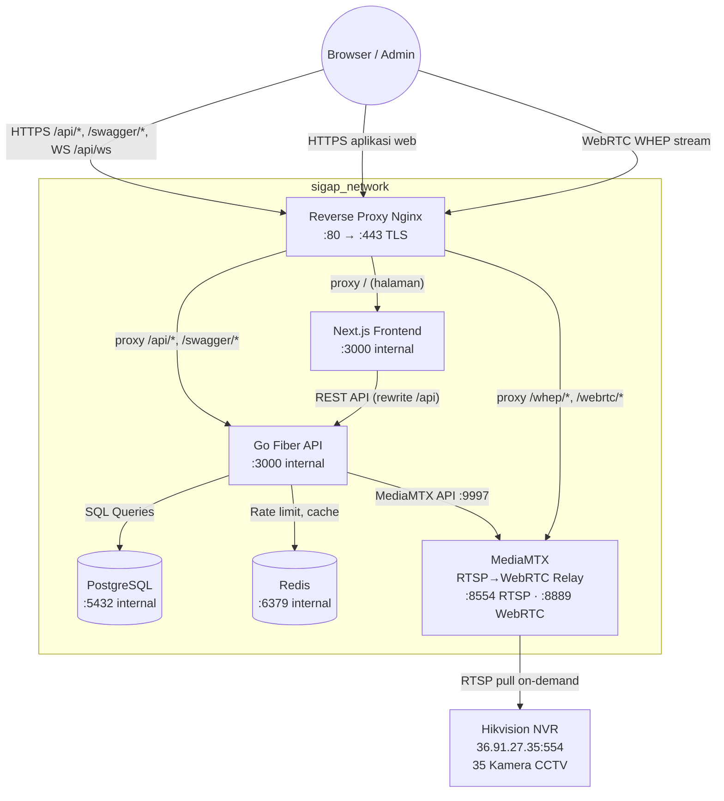
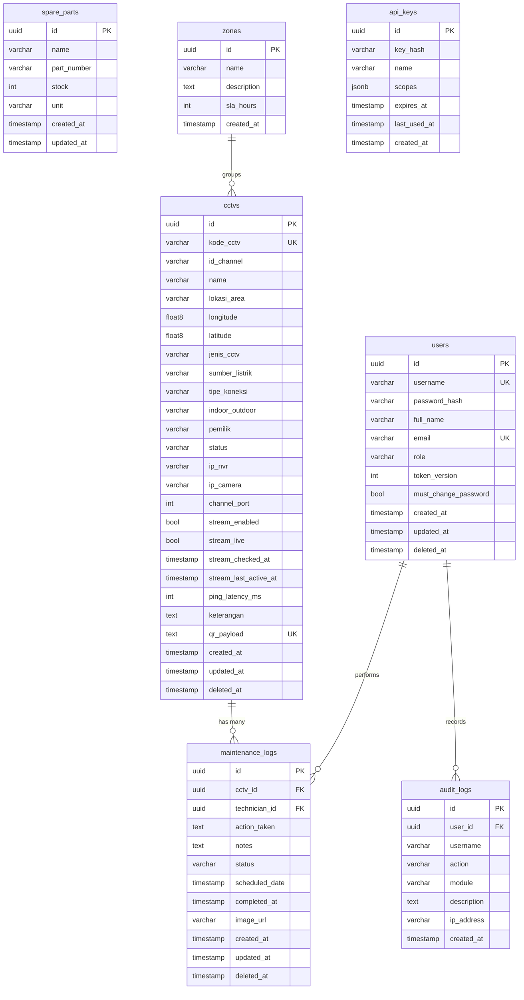

<div align="center">


# SISTEM INFORMASI GANGGUAN & ASET PUSAT

### **S I G A P**

*Platform Manajemen & Monitoring CCTV Terpadu*  
*Kawasan Ibu Kota Nusantara — OIKN*

---


</div>

---

> **SIGAP** adalah sistem internal OIKN untuk monitoring, inventarisasi, dan pemeliharaan seluruh aset CCTV di Kawasan IKN Nusantara secara terpusat. Sistem ini menyediakan live streaming, deteksi status kamera secara real-time, dan manajemen gangguan aset berbasis web.

---

## 🚀 Fitur Utama

- **Dashboard Analitik Real-time** — Statistik total CCTV, pemeliharaan bulan ini, tren 6 bulan, distribusi status, dan peringatan pekerjaan *overdue*.
- **Master Data CCTV** — CRUD lengkap dengan filter, pencarian, paginasi, ekspor CSV, QR Code terenkripsi AES-256-GCM, import massal Excel (max 1.000 baris), dan hapus massal.
- **QR Code Scanner** — Identifikasi aset CCTV via kamera perangkat langsung di browser (`html5-qrcode`).
- **Peta Sebaran CCTV** — Visualisasi lokasi seluruh 35 kamera di peta interaktif (Leaflet.js). Marker menampilkan status live 🟢/🔴 secara real-time. Klik marker untuk popup stream langsung.
- **Live Streaming CCTV** — RTSP → WebRTC via MediaMTX (zero-transcoding, H.264 native). Sub-stream default untuk efisiensi bandwidth. Akses Live View khusus Admin.
- **Live Status Detection** — Probe pasif tiap 2 menit untuk 17 kamera Metro-E (`10.20.105.x`) via ICMP ping; kamera GSM dipantau via MediaMTX path list (zero data consumption). Sejak verifikasi aktif, status end-to-end juga diuji periodik/manual dengan bukti sumber benar-benar mengirim track, sehingga `idle` on-demand tidak lagi disalahartikan sebagai offline. Badge 🟢/🔴/🟡/⚪ di peta dan monitor grid diperbarui real-time via WebSocket.
- **Monitor Multi-Kamera** — Grid view 2×2, 3×3, 4×4 di halaman `/monitor` (Admin only). Border status live per sel.
- **Log Pemeliharaan** — CRUD riwayat pemeliharaan, filter status & rentang tanggal, ekspor CSV, laporan PDF, unggah foto bukti (EXIF/GPS dihapus otomatis, akses dilindungi JWT).
- **Pengecekan Lapangan** — Checklist kondisi kamera, foto bukti, laporan PDF per kegiatan.
- **Jadwal Pemeliharaan** — Kalender penjadwalan preventif per kamera, notifikasi jadwal jatuh tempo.
- **Inventaris Suku Cadang** — CRUD stok komponen, riwayat penggunaan terhubung ke log pemeliharaan.
- **SLA & Zona** — Kebijakan target penyelesaian per zona, monitoring kepatuhan SLA & laporan overdue.
- **Laporan Kustom** — Laporan pemeliharaan fleksibel berdasarkan filter periode, zona, dan teknisi.
- **Kinerja Teknisi** — Statistik produktivitas dan rekap penyelesaian tugas per teknisi.
- **API Key & Webhook** — Integrasi pihak ketiga via API Key (scoped), webhook event real-time.
- **Multi-Site** — Manajemen beberapa lokasi/site dalam satu sistem.
- **Push Notification & Email** — Notifikasi browser (PWA) dan email per event (gangguan, SLA, jadwal).
- **Manajemen Pengguna RBAC** — Kontrol akun Admin/Teknisi, reset password, paksa ganti password login pertama.
- **Audit Log** — Rekam jejak seluruh aktivitas operasional (Admin only), ekspor CSV.
- **Dark/Light Mode** — Toggle tema antarmuka sesuai preferensi.
- **Dokumentasi API Swagger** — Integrasi Swagger UI (nonaktif di produksi).

---

## 🛠 Tech Stack

| Layer | Teknologi | Versi |
| :--- | :--- | :--- |
| **Backend** | Go, Fiber, GORM | Go 1.26, Fiber v2, GORM v1 |
| **Frontend** | Next.js, React, Tailwind CSS, Lucide React | Next.js 15, React 19, Tailwind CSS v4 |
| **Database** | PostgreSQL Alpine | 15 |
| **Cache / Pub-Sub** | Redis | 7 Alpine |
| **Streaming** | MediaMTX (RTSP→WebRTC/WHEP) | Latest |
| **Containerization** | Docker, Docker Compose, Nginx reverse proxy | - |
| **Auth** | JWT, Bcrypt | golang-jwt/jwt v5 |
| **Enkripsi** | AES-256-GCM | crypto/aes |
| **Dokumentasi API** | Swagger/OpenAPI | swaggo/swag |
| **QR Scanner** | html5-qrcode | v2.3.8 |
| **QR Code Server-side** | skip2/go-qrcode | - |
| **Excel Processing** | excelize | v2 |
| **Laporan PDF** | go-pdf/fpdf | v0.9.0 |
| **Logger** | Uber Zap | - |
| **Validation** | go-playground/validator | v10 |
| **Realtime** | Fiber WebSocket | v2 |
| **Peta** | Leaflet.js | - |
| **Video Player** | WebRTC/WHEP (native browser) | - |

---

## 🏗 Arsitektur Sistem



> **7 Docker service:** `db` · `redis` · `api` · `frontend` · `nginx` · `backup` · `mediamtx`

---

## 📂 Struktur Proyek

```text
SIGAP/
├── docker-compose.yml          # Orkestrasi 7 service (db, redis, api, frontend, nginx, backup, mediamtx)
├── mediamtx.yml                # Konfigurasi MediaMTX (RTSP→WebRTC, path on-demand)
├── nginx/                      # Reverse proxy + sertifikat TLS
├── backup/                     # Script backup database otomatis
├── monitoring/                 # Konfigurasi monitoring sistem
├── mobile/                     # React Native mobile app (in progress)
├── scripts/                    # Skrip utilitas & maintenance
├── secrets/                    # Secret files (tidak di-commit)
├── .env.example                # Template secret untuk Docker Compose
├── makefile
├── README.md
├── .gitignore
├── docs/
│   ├── ROADMAP.md              # Rencana pengembangan & status fase (Sprint 1–41+)
│   ├── AGENTS.md               # Aturan kerja untuk AI agent & keputusan operasional
│   ├── DESIGN.md               # Panduan desain sistem
│   ├── TESTING.md              # Matriks pengujian & manual test
│   ├── changelog.md            # Changelog milestone monorepo
│   ├── MIGRATION.md            # Prosedur migrasi DB versioned
│   └── SECURITY-AUDIT.md      # Hasil audit keamanan
├── backend/
│   ├── main.go                    # Entry point, Fiber init, migrasi, graceful shutdown
│   ├── Dockerfile                 # Multi-stage Go build
│   ├── go.mod / go.sum
│   ├── .env.example / .env.docker.example
│   ├── migrations/                # 22+ file migration SQL versioned (golang-migrate)
│   ├── cmd/migrate/               # CLI manual migrasi: up | down | version
│   ├── config/
│   │   ├── database.go            # Koneksi PostgreSQL + connection pooling
│   │   └── migrate.go             # Migrasi versioned
│   ├── models/
│   │   ├── setup.go               # Base structs, AutoMigrate list
│   │   ├── cctv.go                # CCTV struct + streaming fields + live status
│   │   ├── audit_log.go           # AuditLog struct
│   │   ├── spare_part.go          # SparePart & SparePartUsage
│   │   ├── zone.go                # Zone & SLAPolicy
│   │   ├── api_key.go             # APIKey (hash, scope, expiry)
│   │   ├── webhook.go             # Webhook endpoint & delivery log
│   │   └── seeder.go              # SeedAdmin
│   ├── handlers/
│   │   ├── auth.go                # Login, me, profile, change-password
│   │   ├── user.go                # CRUD user, ResetPassword
│   │   ├── cctv.go                # CRUD, Scan, Template, Import, BulkDelete, QR
│   │   ├── maintenance.go         # Log pemeliharaan (CRUD, CSV, PDF, foto)
│   │   ├── field_maintenance.go   # Pengecekan lapangan (checklist, foto, PDF)
│   │   ├── dashboard.go           # Summary, Tasks, Digest
│   │   ├── stream.go              # Stream URL, health monitor, snapshots
│   │   ├── stream_probe.go        # RTSP probe engine (Metro-E ICMP, GSM MediaMTX)
│   │   ├── spare_part.go          # Inventaris suku cadang
│   │   ├── zone.go / sla.go       # Zona & SLA policy
│   │   ├── schedule.go            # Jadwal pemeliharaan
│   │   ├── api_key.go             # API Key CRUD
│   │   ├── webhook.go             # Webhook CRUD & delivery
│   │   ├── site.go                # Multi-site management
│   │   ├── report.go              # Laporan PDF & kustom
│   │   ├── audit.go               # Audit log
│   │   ├── upload.go              # Upload (strip EXIF) & serve file
│   │   └── health.go              # Health check
│   ├── middleware/
│   │   ├── auth.go                # JWT Protected & RequireRole
│   │   ├── csrf.go, security.go, limiter.go, logger.go, recovery.go
│   ├── routes/                    # Registrasi semua route per modul
│   ├── utils/
│   │   ├── encryption.go          # AES-256-GCM encrypt/decrypt
│   │   ├── jwt.go                 # Token generate/validate
│   │   ├── rtsp_probe.go          # ProbeICMP, IsMetroE, BuildStreamPath
│   │   ├── mediamtx.go            # MediaMTX API client
│   │   ├── websocket.go           # Event broadcast
│   │   ├── pagination.go          # SQL-safe pagination
│   │   └── logger.go              # Zap dual output logger
│   └── uploads/                   # Foto pemeliharaan (dilindungi JWT)
├── frontend/
│   ├── Dockerfile                 # Multi-stage Next.js build
│   ├── package.json
│   ├── next.config.ts             # Rewrites /api → backend
│   ├── public/
│   │   ├── manifest.json          # PWA manifest
│   │   └── icons/                 # PWA icons 192×192 & 512×512
│   └── src/
│       ├── app/
│       │   ├── layout.tsx         # Root layout + providers + metadata
│       │   ├── globals.css        # Tailwind v4 + custom animations
│       │   ├── login/             # Halaman login
│       │   ├── dashboard/         # Dashboard analitik & tugas
│       │   ├── cctv/              # Master CCTV + QR Scanner
│       │   ├── maintenance/       # Log pemeliharaan
│       │   ├── field-maintenance/ # Pengecekan lapangan
│       │   ├── monitor/           # Monitor multi-kamera (Admin)
│       │   ├── sebaran-cctv/      # Peta sebaran CCTV
│       │   ├── suku-cadang/       # Inventaris suku cadang
│       │   ├── zona/              # Manajemen zona
│       │   ├── sla/               # SLA monitoring
│       │   ├── schedules/         # Jadwal pemeliharaan
│       │   ├── kalender/          # Kalender tugas
│       │   ├── laporan-kustom/    # Laporan kustom
│       │   ├── kinerja-teknisi/   # Statistik kinerja teknisi
│       │   ├── ringkasan/         # Ringkasan operasional
│       │   ├── api-keys/          # Manajemen API Key (Admin)
│       │   ├── webhooks/          # Manajemen Webhook (Admin)
│       │   ├── sites/             # Multi-site (Admin)
│       │   ├── audit-logs/        # Audit log (Admin)
│       │   ├── users/             # Manajemen pengguna (Admin)
│       │   ├── pemberitahuan/     # Notifikasi
│       │   ├── profile/           # Profil & change password
│       │   └── change-password/   # Ganti password paksa
│       ├── components/
│       │   ├── DashboardLayout.tsx     # Sidebar + header layout
│       │   ├── CCTVMap.tsx             # Peta interaktif Leaflet
│       │   ├── StreamGridView.tsx      # Monitor grid view
│       │   ├── WHEPPlayer.tsx          # WebRTC video player
│       │   ├── AuthenticatedImage.tsx  # Gambar via API (JWT)
│       │   └── ...
│       ├── context/
│       │   ├── AuthContext.tsx         # JWT auth state + sliding session
│       │   ├── ThemeContext.tsx        # Dark/light mode
│       │   └── WebSocketContext.tsx    # Realtime events
│       └── lib/
│           └── api.ts                 # Fetch wrapper + CSRF + auto 401 redirect
```

---

## 🗃 Entity Relationship Diagram (ERD)



---

## 🔌 API Endpoints

> Semua rute berada di bawah prefix `/api`. Endpoint berlabel **JWT** dilindungi autentikasi
> (cookie `sigap_session`); **CSRF** header `X-CSRF-Token` wajib untuk mutasi.
> Swagger UI: `/swagger/index.html` (nonaktif di environment `production`).

### Autentikasi & Profil
| Method | Endpoint | Deskripsi | Auth | Role |
|--------|----------|-----------|------|------|
| POST | `/api/auth/login` | Login | Publik | - |
| POST | `/api/auth/logout` | Logout (revoke token) | JWT | Semua |
| GET | `/api/auth/me` | Profil pengguna | JWT | Semua |
| PUT | `/api/auth/profile` | Update nama tampilan | JWT | Semua |
| POST | `/api/auth/change-password` | Ganti password | JWT | Semua |
| POST | `/api/auth/users` | Buat akun baru | JWT | Admin |

### Master Data CCTV
| Method | Endpoint | Deskripsi | Auth | Role |
|--------|----------|-----------|------|------|
| GET | `/api/cctv/` | Daftar CCTV (paginasi, filter, search) | JWT | Semua |
| GET | `/api/cctv/template` | Download template Excel | JWT | Semua |
| GET | `/api/cctv/:id/qrcode` | Download QR Code PNG | JWT | Semua |
| POST | `/api/cctv/scan` | Scan & identifikasi QR payload | JWT | Semua |
| GET | `/api/cctv/:id` | Detail CCTV | JWT | Semua |
| POST | `/api/cctv/` | Tambah CCTV baru | JWT | Admin |
| POST | `/api/cctv/import` | Import massal dari Excel | JWT | Admin |
| POST | `/api/cctv/bulk-delete` | Hapus massal | JWT | Admin |
| PUT | `/api/cctv/:id` | Update CCTV | JWT | Admin |
| DELETE | `/api/cctv/:id` | Hapus CCTV (soft delete) | JWT | Admin |

### Log Pemeliharaan
| Method | Endpoint | Deskripsi | Auth | Role |
|--------|----------|-----------|------|------|
| GET | `/api/maintenance-logs/` | Daftar log (filter status/tanggal) | JWT | Semua |
| GET | `/api/maintenance-logs/export` | Ekspor CSV | JWT | Teknisi: miliknya / Admin: semua |
| GET | `/api/maintenance-logs/report-pdf` | Laporan PDF | JWT | Teknisi: miliknya / Admin: semua |
| GET | `/api/maintenance-logs/:id` | Detail log | JWT | Semua |
| POST | `/api/maintenance-logs/` | Catat pemeliharaan baru | JWT | Semua |
| PUT | `/api/maintenance-logs/:id` | Update log | JWT | Teknisi: miliknya / Admin: semua |
| DELETE | `/api/maintenance-logs/:id` | Hapus (soft delete) | JWT | Admin |

### Pengecekan Lapangan
| Method | Endpoint | Deskripsi | Auth | Role |
|--------|----------|-----------|------|------|
| GET | `/api/field-maintenance/` | Daftar hasil pengecekan | JWT | Teknisi: miliknya / Admin: semua |
| GET | `/api/field-maintenance/:id` | Detail checklist + foto | JWT | Semua |
| GET | `/api/field-maintenance/:id/report-pdf` | Laporan PDF | JWT | Semua |
| POST | `/api/field-maintenance/` | Catat hasil pengecekan | JWT | Semua |
| DELETE | `/api/field-maintenance/:id` | Hapus (soft delete) | JWT | Admin |

### Live Streaming CCTV
| Method | Endpoint | Deskripsi | Auth | Role |
|--------|----------|-----------|------|------|
| GET | `/api/streams/status` | Status path MediaMTX | JWT | Admin |
| GET | `/api/streams/live-status` | Status live seluruh kamera (efektif + terverifikasi) | JWT | Admin |
| GET | `/api/streams/readiness` | Kesiapan MediaMTX | JWT | Admin |
| GET | `/api/streams/health` | Health monitor stream | JWT | Admin |
| POST | `/api/streams/start-all` | Aktifkan semua stream on-demand | JWT | Admin |
| POST | `/api/streams/stop-all` | Hentikan semua stream | JWT | Admin |
| POST | `/api/streams/:id/start` | Aktifkan stream on-demand | JWT | Admin |
| POST | `/api/streams/:id/verify` | Verifikasi end-to-end status stream | JWT | Admin |
| POST | `/api/streams/:id/stop` | Hentikan stream | JWT | Admin |
| GET | `/api/streams/:id/url` | Generate WHEP/HLS stream URL | JWT | Admin |
| GET | `/api/cctv/:id/snapshot` | Snapshot terbaru kamera | JWT | Admin |
| GET | `/api/cctv/:id/timeline` | Timeline snapshot/kegiatan kamera | JWT | Admin |

### Inventaris Suku Cadang
| Method | Endpoint | Deskripsi | Auth | Role |
|--------|----------|-----------|------|------|
| GET | `/api/spare-parts/` | Daftar suku cadang | JWT | Semua |
| POST | `/api/spare-parts/` | Tambah suku cadang | JWT | Admin |
| PUT | `/api/spare-parts/:id` | Update | JWT | Admin |
| DELETE | `/api/spare-parts/:id` | Hapus | JWT | Admin |
| POST | `/api/spare-parts/:id/use` | Catat pemakaian | JWT | Semua |

### SLA & Zona
| Method | Endpoint | Deskripsi | Auth | Role |
|--------|----------|-----------|------|------|
| GET | `/api/zones/` | Daftar zona | JWT | Semua |
| POST | `/api/zones/` | Tambah zona | JWT | Admin |
| PUT | `/api/zones/:id` | Update zona | JWT | Admin |
| DELETE | `/api/zones/:id` | Hapus zona | JWT | Admin |
| GET | `/api/sla-policies/` | Kebijakan SLA | JWT | Admin |

### Jadwal Pemeliharaan
| Method | Endpoint | Deskripsi | Auth | Role |
|--------|----------|-----------|------|------|
| GET | `/api/schedules/` | Daftar jadwal | JWT | Semua |
| POST | `/api/schedules/` | Buat jadwal baru | JWT | Admin |
| PUT | `/api/schedules/:id` | Update jadwal | JWT | Admin |
| DELETE | `/api/schedules/:id` | Hapus jadwal | JWT | Admin |

### API Key & Webhook
| Method | Endpoint | Deskripsi | Auth | Role |
|--------|----------|-----------|------|------|
| GET | `/api/api-keys/` | Daftar API Key | JWT | Admin |
| POST | `/api/api-keys/` | Generate API Key baru | JWT | Admin |
| DELETE | `/api/api-keys/:id` | Revoke API Key | JWT | Admin |
| GET | `/api/webhooks/` | Daftar Webhook | JWT | Admin |
| POST | `/api/webhooks/` | Tambah Webhook | JWT | Admin |
| DELETE | `/api/webhooks/:id` | Hapus Webhook | JWT | Admin |

### Multi-Site
| Method | Endpoint | Deskripsi | Auth | Role |
|--------|----------|-----------|------|------|
| GET | `/api/sites/` | Daftar site | JWT | Semua |
| POST | `/api/sites/` | Tambah site | JWT | Admin |
| PUT | `/api/sites/:id` | Update site | JWT | Admin |
| DELETE | `/api/sites/:id` | Hapus site | JWT | Admin |

### Manajemen Pengguna
| Method | Endpoint | Deskripsi | Auth | Role |
|--------|----------|-----------|------|------|
| GET | `/api/users/` | Daftar pengguna | JWT | Admin |
| GET | `/api/users/:id` | Detail pengguna | JWT | Admin |
| PUT | `/api/users/:id` | Update pengguna | JWT | Admin |
| DELETE | `/api/users/:id` | Hapus (soft delete) | JWT | Admin |
| POST | `/api/users/:id/reset-password` | Reset password | JWT | Admin |

### Dashboard & Laporan
| Method | Endpoint | Deskripsi | Auth | Role |
|--------|----------|-----------|------|------|
| GET | `/api/dashboard/summary` | Statistik, tren, distribusi, overdue | JWT | Semua |
| GET | `/api/dashboard/tasks` | Tugas teknisi | JWT | Semua |
| GET | `/api/dashboard/digest` | Ringkasan operasional harian | JWT | Admin |
| GET | `/api/audit-logs/` | Audit log | JWT | Admin |
| GET | `/api/audit-logs/export` | Ekspor audit log CSV | JWT | Admin |

### Upload, WebSocket & Utilitas
| Method | Endpoint | Deskripsi | Auth | Role |
|--------|----------|-----------|------|------|
| POST | `/api/upload` | Upload foto (JPEG/PNG/WebP, max 2MB) | JWT | Semua |
| GET | `/api/uploads/:filename` | Ambil foto (dilindungi JWT) | JWT | Semua |
| GET | `/api/ws` | WebSocket real-time (maintenance, live status) | JWT | Semua |
| GET | `/api/health` | Health check API & DB | Publik | - |
| GET | `/swagger/*` | Dokumentasi API Swagger UI | Publik | non-prod |

---

## 🐳 Panduan Instalasi (Docker)

### Prasyarat
- [Docker Desktop](https://www.docker.com/products/docker-desktop) terinstal dan berjalan.
- [Git](https://git-scm.com/) terinstal.

### Langkah-langkah

1. **Clone repositori**
   ```bash
   git clone https://github.com/notyourkise/SIGAP.git
   cd SIGAP
   ```

2. **Siapkan file environment**
   ```bash
   cp .env.example .env
   cp backend/.env.docker.example backend/.env.docker
   ```

3. **Isi secret penting**
   - `.env` (root): `POSTGRES_PASSWORD` **wajib** diisi.
   - `backend/.env.docker`: `DB_PASSWORD`, `JWT_SECRET`, `AES_SECRET_KEY`, `ADMIN_DEFAULT_PASSWORD` (min. 8 karakter), `CORS_ALLOWED_ORIGINS=https://localhost`.

4. **Buat sertifikat TLS**
   Ikuti petunjuk di `nginx/certs/README.md` untuk sertifikat self-signed (development) atau sertifikat resmi (produksi).

5. **Build dan jalankan**
   ```bash
   docker compose up --build -d
   ```

6. **Verifikasi container berjalan**
   ```bash
   docker compose ps
   # Harus ada 7 container: db, redis, api, frontend, nginx, backup, mediamtx
   ```

7. **Akses aplikasi**
   | URL | Keterangan |
   |-----|-----------|
   | `https://localhost` | Aplikasi web (satu-satunya entrypoint) |
   | `https://localhost/sebaran-cctv` | Peta sebaran CCTV |
   | `https://localhost/monitor` | Monitor multi-kamera (Admin only) |
   | `https://localhost/swagger/index.html` | API Docs (non-production) |

8. **Login dengan akun default**
   - **Username**: `admin`
   - **Password**: nilai `ADMIN_DEFAULT_PASSWORD` dari langkah 3.
   *(Sistem akan memaksa ganti password pada login pertama.)*

### Perintah Docker Berguna
```bash
docker compose logs -f              # Log real-time semua service
docker compose stop                 # Hentikan sementara
docker compose down                 # Hentikan & hapus container
docker compose down -v              # Reset total (hapus volume DB)
docker compose up --build -d        # Rebuild & restart
docker compose restart api          # Restart service tertentu
```

---

## 💻 Panduan Instalasi (Lokal / Tanpa Docker)

### Prasyarat
- Go >= 1.26
- Node.js >= 20
- PostgreSQL 15
- Redis 7

### Backend
```bash
cd backend
cp .env.example .env
# Edit .env sesuai konfigurasi lokal
go mod download
go run main.go
# Backend berjalan di port 3000
```

### Frontend
```bash
cd frontend
npm install
npm run dev
# Frontend berjalan di port 3001
```

---

## ⚙️ Environment Variables

| Variable | Deskripsi | Default | Wajib |
|----------|-----------|---------|-------|
| `DB_HOST` | Host database | `localhost` (Docker: `db`) | Ya |
| `DB_PORT` | Port database | `5432` | Ya |
| `DB_USER` | Username database | - | Ya |
| `DB_PASSWORD` | Password database | - | Ya |
| `DB_NAME` | Nama database | - | Ya |
| `JWT_SECRET` | Secret key JWT | - | Ya |
| `AES_SECRET_KEY` | Secret key AES-256 enkripsi QR | - | Ya |
| `ADMIN_DEFAULT_PASSWORD` | Password admin awal (min. 8 karakter) | - | Ya (DB baru) |
| `APP_ENV` | `development` / `staging` / `production` | `development` | Tidak |
| `CORS_ALLOWED_ORIGINS` | Origin yang diizinkan | `http://localhost:3001` | Tidak |
| `MEDIAMTX_API_URL` | URL MediaMTX API internal | `http://mediamtx:9997` | Tidak |
| `REDIS_ADDR` | Alamat Redis | `redis:6379` | Tidak |
| `DB_MAX_OPEN_CONNS` | Max open connections | `50` | Tidak |
| `DB_MAX_IDLE_CONNS` | Max idle connections | `10` | Tidak |
| `POSTGRES_PASSWORD` | (Docker) Password PostgreSQL | - | Ya (Docker) |
| `POSTGRES_DB` | (Docker) Nama DB PostgreSQL | `sigap_db` | Tidak |

---

## 🔑 Kredensial Default

Setelah instalasi berhasil, satu akun Administrator otomatis dibuat dengan password dari `ADMIN_DEFAULT_PASSWORD`.

- **Username**: `admin`
- **Password**: nilai `ADMIN_DEFAULT_PASSWORD`

> [!WARNING]
> Password admin **tidak di-reset** oleh seeder pada setiap startup.
> Sistem akan **memaksa penggantian password** pada login pertama.

---

## 📄 Lisensi

Proyek ini dibangun dan ditujukan sebagai **Proyek Internal OIKN — Kawasan Ibu Kota Nusantara**.
