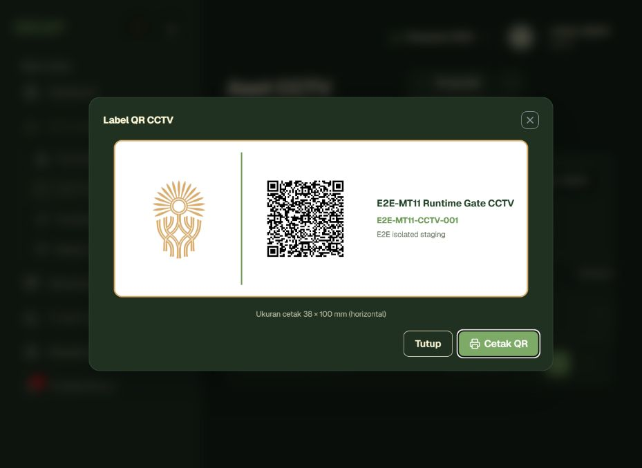

# MT-11 — Bukti Runtime Lifecycle QR

> **Cakupan:** sub-gate QR untuk Task 1A / BB-10, bukan acceptance agregat seluruh MT-11.
>
> **Hasil sub-gate:** `PASS` · **Status suite agregat MT-11:** tetap `NOT RUN` sampai skenario API key dan webhook dijalankan.

## Metadata

| Field | Value |
|---|---|
| Source SHA | `914e0432b9b6bd7c3663c09ebfbee27f1d9640e4` |
| Source archive SHA-256 | `aee6273d5308e5dd49100419b8290222a4171f4b8b74d3649fe802fc0bc3810f` |
| Tester | Anto — API checks, QR decoder, dan browser black-box |
| Timestamp | 2026-08-20 12:51 WITA |
| Environment | Staging terisolasi di VPS, Compose project `sigap_mt11`, diakses melalui SSH tunnel ke loopback `127.0.0.1:18080` |
| Fixture | Prefix `E2E-MT11-`; satu CCTV dan satu akun teknisi sementara |
| Production mutation | Tidak ada |
| Cleanup | `PASS`; container, network, volume, source staging, dan tunnel dihapus |

Staging memakai database, Redis, volume, nama container, project Compose, dan subnet tersendiri. Production tetap berjalan selama dan setelah pengujian.

## Hasil

| Pemeriksaan | Actual | Status |
|---|---|---|
| Rotasi API mempertahankan identitas aset | ID CCTV sebelum/sesudah rotasi sama | PASS |
| Payload dan PNG berubah | Hash payload dan PNG sebelum/sesudah berbeda | PASS |
| Cache label | Respons PNG sebelum dan sesudah rotasi memakai `Cache-Control: no-store` | PASS |
| Isi PNG dapat dipindai | QR decoder membaca payload dari kedua PNG; hash hasil decode sama dengan hash payload API masing-masing | PASS |
| QR baru aktif | `POST /api/cctv/scan` mengembalikan HTTP 200 dan ID fixture yang sama | PASS |
| QR lama tidak aktif | `POST /api/cctv/scan` mengembalikan HTTP 404 dengan pesan QR tidak aktif/sudah dirotasi | PASS |
| RBAC negatif | Teknisi mendapat HTTP 403 ketika memanggil rotasi QR | PASS |
| Audit trail | Event `ROTATE_QR_CODE` ditemukan | PASS |
| Rotasi melalui UI | Dialog risiko muncul dan toast sukses ditampilkan | PASS |
| Label tanpa hard refresh | Data PNG pada modal label berubah langsung setelah rotasi; halaman tetap `/cctv` tanpa reload | PASS |
| Aksi cetak | Tombol `Cetak QR` dapat dijalankan dan aplikasi mengonfirmasi satu label berhasil disiapkan untuk dicetak | PASS |
| Sinkronisasi UI/backend | Hash payload hasil decode dari label UI terbaru sama dengan hash `qr_payload` detail backend | PASS |
| Cleanup staging | Seluruh resource `sigap_mt11` dan `/opt/sigap-mt11` dihapus; tidak ada resource staging tersisa | PASS |
| Kondisi production setelah cleanup | Frontend, API, Nginx, backup, Grafana, Prometheus berjalan; PostgreSQL, Redis, API, dan MediaMTX sehat | PASS |

Hash bukti utama:

- PNG label UI sebelum rotasi: `29f812a3f7d7a62a6fe45d85821feb7e62ceb087f65a3e0198f3cab49c1c6566`.
- PNG label UI sesudah rotasi: `3ca49297b595eee3ef7e3c5670e6170fb08b9aeb0a7168613243573bb004e931`.
- Payload hasil decode sebelum rotasi: `1454334bf2ba57a475f1934694f12066a7e3d3c49805742b2ab9356051270eb7`.
- Payload hasil decode sesudah rotasi: `1295df4f5062650f90afb018eb2228fba800e3bce9883a9b34652e43558e523e`.
- Hash payload backend aktif sesudah rotasi UI: `1295df4f5062650f90afb018eb2228fba800e3bce9883a9b34652e43558e523e`.

## Batasan dan Kesimpulan

Pemindaian menggunakan payload yang didekode langsung dari PNG label aktual, lalu dikirim ke endpoint scanner. Ini membuktikan isi label, lifecycle payload, dan identifikasi aset end-to-end pada aplikasi, tetapi tidak menguji izin kamera atau kualitas kamera perangkat fisik.

Sub-gate QR Task 1A dan acceptance BB-10 dinyatakan `PASS`. Suite agregat MT-11 belum boleh dinyatakan `PASS` karena regenerasi API key, retensi webhook, dan perluasan role-negative aggregate belum dijalankan.
